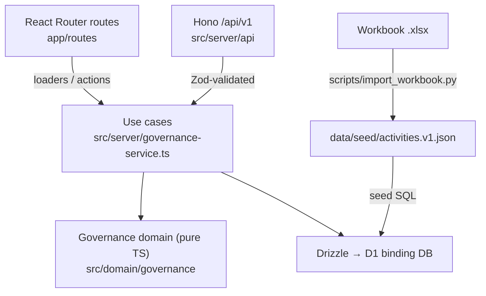
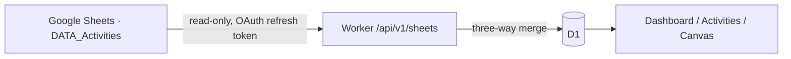

# Full Stack Governance System

Web application for planning, executing, and verifying software delivery against the 14 activities in `Full_Stack_Governance_Workbook.xlsx`.

## Status

**Deployed on Cloudflare Workers with Google login and Google Sheets sync.** Activities are not marked DONE automatically; governance gates still apply.

| Item | State |
| --- | --- |
| Stack decision (ADR-001) | PROPOSED — awaiting owner approval |
| Product docs ACT-01..06 | DRAFT — awaiting owner approval (ACT-02 has no interviews yet) |
| First feature (status + evidence + progress) | Implemented, tested locally |
| Canvas Multiview `/canvas` (ADR-002/003) | Implemented locally: 5 views × 2 datasets (Governance live, Clean Sea **não validado**) |
| Design system audit (ADR-004) | G1–G4 done; showcase at `/showcase`; G5 partially verified |
| Data-viz quality audit (33 criteria) | 0 MUST failing — `docs/quality/dv-audit_v0.1.md` |
| Google login + allow-list (ADR-005) | Implemented; production fails closed without secrets |
| Google Sheets → app sync (ADR-005) | Implemented: automatic on open (default) or preview + apply; read-only scope |
| Deploy (ACT-12) | Cloudflare Worker `governance-system` + D1 `governance` (production env) |

No workbook activity is marked DONE. See `docs/plan/implementation-plan_A-G.md` for the roadmap and `docs/governance/13_decision-log.md` for decisions.

## Stack (ADR-001, proposed)

| Layer | Technology |
| --- | --- |
| UI | React Router v7 (SSR on Workers), React 19, TypeScript |
| UI kit | Tailwind CSS v4 + shadcn/ui conventions, tokens from the workbook |
| API | Hono on Cloudflare Workers, versioned under `/api/v1` |
| Database | Cloudflare D1 (SQLite) + Drizzle ORM |
| Validation | Zod |
| Tests | Vitest (unit + integration on local D1), Playwright (E2E) |
| CI | GitHub Actions: lint, typecheck, test, build, E2E |

## Architecture



- `workers/app.ts` is the Worker entry: Hono serves `/api/v1/*`, React Router serves everything else.
- `src/domain/governance` has no framework imports. ESLint enforces this.
- The workbook is the **initial reference dataset**. After import, D1 is the operational source of truth. The import never writes the workbook.

## Google Sheets → app



- Edit Status, Priority, Owner, Due, Evidence or Notes in the sheet → open the dashboard (or "Recarregar dados") → the app shows the new value. Every applied change is audited.
- `/sheets` ("Planilha") shows the source, the plan, conflicts and invalid cells, and the mode toggle: **Automático ao abrir** (default) or **Prévia + Aplicar**.
- **Team guide (plain language, PT-BR):** `docs/guia-do-time_planilha-e-integracoes.md`.
- A change made only in the app is never reverted by the sheet; a field changed on both sides is a conflict and is never applied automatically. Details: `docs/architecture/adr-005_google-auth-sheets-sync.md`.

## Production setup (one time)

1. Google Cloud Console → APIs & Services → Credentials → the OAuth client (type *Web*) → **Authorized redirect URIs**: add `https://governance-system.<your-workers-subdomain>.workers.dev/auth/google/callback` (and `http://localhost:5173/auth/google/callback` for local tests).
2. Enable the **Google Sheets API** in the same project. On the OAuth consent screen, add the scope `.../auth/spreadsheets.readonly`; if the app is in *Testing*, add the allowed accounts as test users (refresh tokens then expire after 7 days).
3. Cloudflare secrets (`--env production`): `GOOGLE_CLIENT_ID`, `GOOGLE_CLIENT_SECRET`, `SESSION_SECRET`, `TOKEN_ENCRYPTION_KEY`, `ALLOWED_EMAILS`, `SPREADSHEET_ID` — e.g. `npx wrangler secret put ALLOWED_EMAILS --env production`.
4. Open the app → **Entrar com Google** → Settings → **Conectar Google Sheets** (one consent with read-only access).

## Deploy

```bash
npm run db:migrate:remote
```

```bash
npm run seed:remote
```

```bash
npm run deploy
```

`seed:remote` uses `INSERT OR IGNORE` and never overwrites existing records.

Production URL: `https://governance-system.contato-adulto-tdah.workers.dev`.

**Where the Static Assets upload API is blocked** (it authenticates uploads with a short-lived JWT that some proxies replace, so uploads return 401), use:

```bash
npm run deploy:kv-assets
```

It uploads `build/client/assets/*` to the `STATIC` KV namespace and deploys the Worker without the assets binding; the Worker then serves `/assets/*` from KV (`src/server/static-kv.ts`). The standard `npm run deploy` needs no code change.

## Canvas Multiview and design system

- `/canvas` — one graph (`src/domain/diagram`), five views: Infográfico, Tutorial, BPMN, Organograma, Diagrama complexo. Collapsible/resizable sidebars, Inspector with metanotes, state in the URL (`?dataset=&view=&node=`). Read-only: edit on `/activities/:id`.
- `/showcase` — catalogue generated from `docs/design-system/COMPONENT_REGISTRY.json`.
- Design system docs: `docs/design-system/` (inventory, taxonomy, tokens, registry, architecture). Diagramming rules: `docs/design/diagramming-system.md`.
- Source material from `Archive.zip` is kept unchanged in `reference/loop-design/`.

## Core governance rules

- An activity counts as complete only when `status = DONE` and at least one evidence record exists.
- A dependency is satisfied only when the predecessor is effectively complete.
- Flags, in workbook precedence: `BLOCKED` > `NO EVIDENCE` > `DEP PENDING` > `OVERDUE`.
- The eight workbook statuses are preserved: `NOT STARTED`, `IN PROGRESS`, `BLOCKED`, `PREPARED`, `IN REVIEW`, `APPROVED`, `VERIFIED`, `DONE`.
- Dashboard metrics are calculated on the server.
- Every status change and evidence record writes an audit event (actor, time, from, to) in the same atomic `batch()`.
- Current policy: status changes are **flagged, not rejected** (mirrors the workbook). See decision D-004.

## Local setup

Requirements: Node.js 22 LTS, npm, Python 3 with `openpyxl` (only to re-import the workbook).

```bash
npm ci
```

```bash
npm run db:migrate:local
```

```bash
npm run seed:local
```

```bash
npm run dev
```

Open `http://localhost:5173/dashboard`. Health check: `GET /api/v1/health`.

Reset local data: `npm run db:reset:local`.

## Scripts

| Script | Purpose |
| --- | --- |
| `dev` / `build` / `preview` | Run, build, preview the Worker locally |
| `lint` / `typecheck` | ESLint; `wrangler types` + React Router typegen + `tsc -b` |
| `test` | Vitest unit + integration (local in-memory D1) |
| `test:e2e` | Playwright on an isolated local D1 (`.wrangler/e2e`) |
| `import:workbook` | Re-generate `data/seed/activities.v1.json` from the workbook |
| `extract:cleansea` | Re-generate `data/reference/cleansea.v1.json` from the Clean Sea prototype |
| `import:dv-criteria` | Re-generate `data/quality/dv-criteria.v1.json` from the CSV |
| `db:generate` | Generate a SQL migration from `src/server/db/schema.ts` |
| `db:migrate:local` / `seed:local` / `db:reset:local` | Local D1 lifecycle |
| `db:migrate:remote` / `seed:remote` | Production D1 (`--env production`) |
| `deploy` / `deploy:kv-assets` | Production deploy (standard / assets from KV) |

## API (v1)

| Method | Path | Purpose |
| --- | --- | --- |
| GET | `/api/v1/health` | D1 connectivity |
| GET | `/api/v1/activities` | Activities with effective state and flag |
| GET | `/api/v1/activities/:id` | Detail, dependency, dependents, evidence, history |
| PATCH | `/api/v1/activities/:id/status` | `{ "status": "<one of 8>" }` → returns warnings |
| POST | `/api/v1/activities/:id/evidence` | `{ "kind": "link\|commit\|file\|text", "ref": "...", "note"?: "..." }` |
| GET | `/api/v1/evidence` | All evidence |
| GET | `/api/v1/dashboard` | Server-computed progress, areas, flags, gates |
| GET | `/api/v1/me` | Signed-in user and auth mode |
| GET | `/api/v1/sheets/status` | Sync mode, connection, last run |
| GET | `/api/v1/sheets/preview` | Read the sheet and return the plan (no writes) |
| POST | `/api/v1/sheets/sync` | `{ "resolve"?: ["ACT-02:status"] }` apply plan (+ chosen conflicts) |
| PUT | `/api/v1/sheets/mode` | `{ "mode": "auto" \| "preview" }` |

Every route except `/api/v1/health`, `/login` and `/auth/*` requires a session. Actor = signed-in e-mail (`X-Actor` is accepted only in the local development bypass).

## Repository structure

```text
app/                     # React Router routes, root layout, tokens (app.css)
workers/app.ts           # Worker entry (Hono + React Router)
src/domain/governance/   # Pure business rules and fixture schema
src/domain/diagram/      # Universal graph, adapters, 5 view projectors (pure)
src/design-system/       # Registry schema + loader
src/server/              # API, use cases, Drizzle schema and seed builder
src/components/          # UI primitives (shadcn), governance badges, patterns (ChoiceCard)
app/components/canvas/   # Canvas layouts and diagram components
migrations/              # D1 SQL migrations (drizzle-kit)
data/source/             # Original workbook (read-only input)
data/seed/               # Versioned fixture generated from the workbook
scripts/                 # Import and seed generators
tests/                   # unit, integration, e2e
docs/                    # Charter, discovery, requirements, UX, ADRs, plan, decisions
reference/xls-pwa/       # Legacy PWA + Apps Script sync (reference only)
reference/loop-design/   # ADR-002/003/004, prototypes, shadcn package, DV criteria (reference only)
data/reference/          # Clean Sea fixture (not validated)
data/quality/            # Data-viz criteria fixture
```

## Security and quality

Never commit credentials (`.dev.vars` is git-ignored; production values are Cloudflare secrets). All inputs are validated with Zod. Access requires Google login with an allowed e-mail; the Sheets refresh token is stored encrypted (AES-GCM). Do not report a task as complete without evidence.

## Next action

1. Owner reviews `docs/product/01_project-charter_v0.1.md` and `docs/product/03_requirements_v0.1.md`.
2. Owner approves or changes ADR-001 and decisions D-004, D-006, D-007.
3. Run the five discovery interviews (ACT-02). Do not fabricate them.
