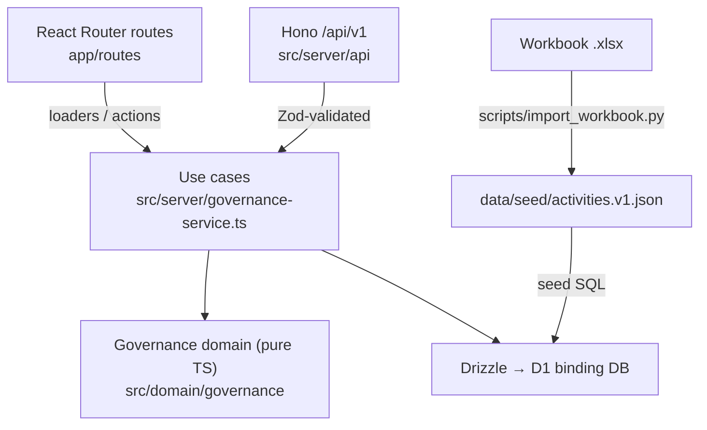

# Full Stack Governance System

Web application for planning, executing, and verifying software delivery against the 14 activities in `Full_Stack_Governance_Workbook.xlsx`.

## Status

**Scaffold + first vertical slice (ACT-07) running locally. Not deployed.**

| Item | State |
| --- | --- |
| Stack decision (ADR-001) | PROPOSED — awaiting owner approval |
| Product docs ACT-01..06 | DRAFT — awaiting owner approval (ACT-02 has no interviews yet) |
| First feature (status + evidence + progress) | Implemented, tested locally |
| Remote Cloudflare resources / deploy | Not created (requires approval) |

No workbook activity is marked DONE. See `docs/plan/implementation-plan_A-G.md` for the roadmap and `docs/governance/13_decision-log.md` for decisions.

## Stack (ADR-001, proposed)

| Layer | Technology |
| --- | --- |
| UI | React Router v7 (SSR on Workers), React 19, TypeScript |
| UI kit | Tailwind CSS v4 + shadcn/ui conventions, tokens from the workbook |
| API | Hono on Cloudflare Workers, versioned under `/api/v1` |
| Database | Cloudflare D1 (SQLite) + Drizzle ORM |
| Validation | Zod |
| Tests | Vitest (unit + integration on local D1), Playwright (E2E) |
| CI | GitHub Actions: lint, typecheck, test, build, E2E |

## Architecture



- `workers/app.ts` is the Worker entry: Hono serves `/api/v1/*`, React Router serves everything else.
- `src/domain/governance` has no framework imports. ESLint enforces this.
- The workbook is the **initial reference dataset**. After import, D1 is the operational source of truth. The import never writes the workbook.

## Core governance rules

- An activity counts as complete only when `status = DONE` and at least one evidence record exists.
- A dependency is satisfied only when the predecessor is effectively complete.
- Flags, in workbook precedence: `BLOCKED` > `NO EVIDENCE` > `DEP PENDING` > `OVERDUE`.
- The eight workbook statuses are preserved: `NOT STARTED`, `IN PROGRESS`, `BLOCKED`, `PREPARED`, `IN REVIEW`, `APPROVED`, `VERIFIED`, `DONE`.
- Dashboard metrics are calculated on the server.
- Every status change and evidence record writes an audit event (actor, time, from, to) in the same atomic `batch()`.
- Current policy: status changes are **flagged, not rejected** (mirrors the workbook). See decision D-004.

## Local setup

Requirements: Node.js 22 LTS, npm, Python 3 with `openpyxl` (only to re-import the workbook).

```bash
npm ci
```

```bash
npm run db:migrate:local
```

```bash
npm run seed:local
```

```bash
npm run dev
```

Open `http://localhost:5173/dashboard`. Health check: `GET /api/v1/health`.

Reset local data: `npm run db:reset:local`.

## Scripts

| Script | Purpose |
| --- | --- |
| `dev` / `build` / `preview` | Run, build, preview the Worker locally |
| `lint` / `typecheck` | ESLint; `wrangler types` + React Router typegen + `tsc -b` |
| `test` | Vitest unit + integration (local in-memory D1) |
| `test:e2e` | Playwright on an isolated local D1 (`.wrangler/e2e`) |
| `import:workbook` | Re-generate `data/seed/activities.v1.json` from the workbook |
| `db:generate` | Generate a SQL migration from `src/server/db/schema.ts` |
| `db:migrate:local` / `seed:local` / `db:reset:local` | Local D1 lifecycle |

## API (v1)

| Method | Path | Purpose |
| --- | --- | --- |
| GET | `/api/v1/health` | D1 connectivity |
| GET | `/api/v1/activities` | Activities with effective state and flag |
| GET | `/api/v1/activities/:id` | Detail, dependency, dependents, evidence, history |
| PATCH | `/api/v1/activities/:id/status` | `{ "status": "<one of 8>" }` → returns warnings |
| POST | `/api/v1/activities/:id/evidence` | `{ "kind": "link\|commit\|file\|text", "ref": "...", "note"?: "..." }` |
| GET | `/api/v1/evidence` | All evidence |
| GET | `/api/v1/dashboard` | Server-computed progress, areas, flags, gates |

Actor: `X-Actor` header, default `local-dev`. Authentication is an open decision (D-006).

## Repository structure

```text
app/                     # React Router routes, root layout, tokens (app.css)
workers/app.ts           # Worker entry (Hono + React Router)
src/domain/governance/   # Pure business rules and fixture schema
src/server/              # API, use cases, Drizzle schema and seed builder
src/components/          # UI primitives (shadcn style) and governance badges
migrations/              # D1 SQL migrations (drizzle-kit)
data/source/             # Original workbook (read-only input)
data/seed/               # Versioned fixture generated from the workbook
scripts/                 # Import and seed generators
tests/                   # unit, integration, e2e
docs/                    # Charter, discovery, requirements, UX, ADRs, plan, decisions
reference/xls-pwa/       # Legacy PWA + Apps Script sync (reference only)
```

## Security and quality

Never commit credentials (`.dev.vars` is git-ignored). All inputs are validated with Zod. Authorization does not exist yet: do not expose this application publicly until D-006 is decided. Do not report a task as complete without evidence.

## Next action

1. Owner reviews `docs/product/01_project-charter_v0.1.md` and `docs/product/03_requirements_v0.1.md`.
2. Owner approves or changes ADR-001 and decisions D-004, D-006, D-007.
3. Run the five discovery interviews (ACT-02). Do not fabricate them.
