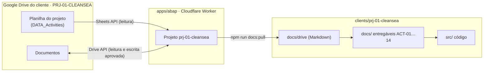

# ABAP — plataforma de serviços da consultoria (monorepo)

ABAP organiza os projetos de clientes da consultoria: cada cliente tem uma pasta no Google Drive, um projeto no ABAP (planilha de governança com 14 atividades) e um workspace neste repositório com documentação estruturada e, depois, código.



## Estrutura

| Pasta | O que é |
|---|---|
| [`apps/abap/`](apps/abap/README.md) | Plataforma ABAP (app web, API, banco, login Google, Sheets e Drive) |
| [`clients/`](clients/) | Um workspace por cliente: `clients/prj-01-cleansea/` |
| [`packages/`](packages/README.md) | Código compartilhado (vazio até ser necessário) |
| [`tools/`](tools/) | Ferramentas do monorepo: novo cliente, checagem, sincronização de docs |
| [`docs/`](docs/) | Regras de operação e entrada de clientes |

## Começar

```bash
npm ci
```

```bash
npm run dev
```

## Novo cliente

```bash
npm run client:new -- PRJ-02 "Nome do Cliente" PRJ-02-NOME
```

Passo a passo completo: [`docs/client-onboarding.md`](docs/client-onboarding.md).

## Verificações

```bash
npm run check:clients && npm run lint && npm run typecheck && npm test && npm run build && npm run test:e2e
```

Instruções para o Claude Code: [`CLAUDE.md`](CLAUDE.md) (monorepo), [`apps/abap/CLAUDE.md`](apps/abap/CLAUDE.md) (plataforma), `clients/<slug>/CLAUDE.md` (cada cliente).
