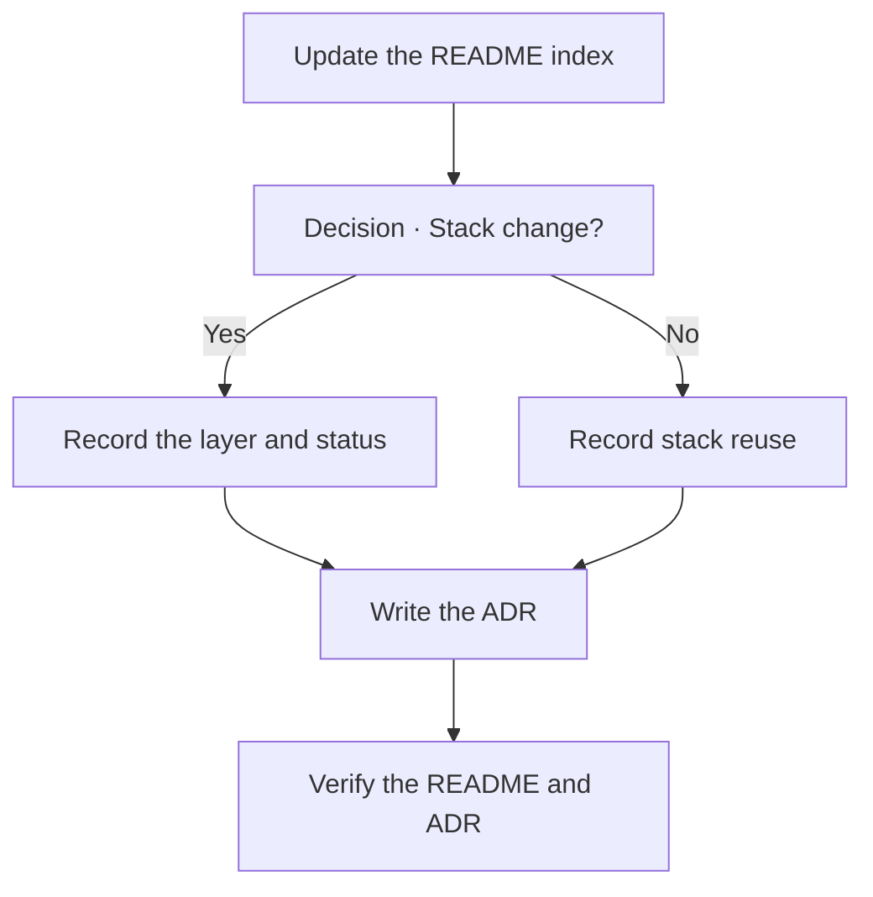
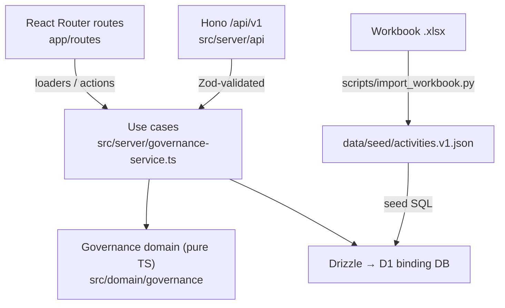
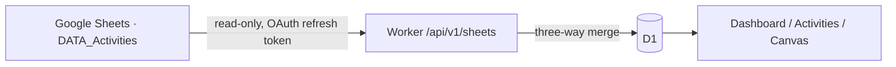

# Full Stack Governance System

## Stack

The table records the configured stack. The stack decision in [ADR-001](docs/architecture/05_adr-001_stack.md) is **PROPOSED** and awaits owner approval.

| Layer | Current engineering baseline | Repository evidence |
| --- | --- | --- |
| Tooling | Node.js 22 LTS, npm workspaces | [Root manifest](../../package.json), [CI](../../.github/workflows/ci.yml) |
| UI | React Router v7 (SSR on Workers), React 19, TypeScript | [App manifest](package.json), [Worker entry](workers/app.ts) |
| Design system | Tailwind CSS v4, shadcn/ui conventions, ABAP bundle tokens | [ADR-007](docs/architecture/adr-007_single-design-system-bundle.md), [Token definitions](docs/design-system/DESIGN_TOKENS.json) |
| Runtime and API | Cloudflare Workers, Hono REST API under `/api/v1` | [Worker configuration](wrangler.jsonc), [Worker entry](workers/app.ts) |
| Data | Cloudflare D1 (SQLite), Drizzle ORM | [D1 configuration](wrangler.jsonc), [Database schema](src/server/db/schema.ts) |
| Validation | Zod | [App manifest](package.json) |
| Integrations | Google OAuth, Google Sheets sync, Google Drive API | [ADR-005](docs/architecture/adr-005_google-auth-sheets-sync.md), [ADR-006](docs/architecture/adr-006_monorepo-multi-project-drive.md) |
| Agents | ABAP MCP via `/mcp`, Claude plugins, agent factory | [ADR-009](docs/architecture/adr-009_mcp-tokens-plugin-marketplace.md), [ADR-010](docs/architecture/adr-010_agent-factory.md) |
| Tests and CI | Vitest (unit and integration on local D1), Playwright (end-to-end), GitHub Actions | [App scripts](package.json), [CI workflow](../../.github/workflows/ci.yml) |

The earlier workbook-token decision D-013 was superseded by [ADR-007](docs/architecture/adr-007_single-design-system-bundle.md).

## ADR index

| ADR | Record status | Engineering impact |
| --- | --- | --- |
| [ADR-UIX-001](docs/architecture/adr-uix-001_gestalt-whitespace.md) | PROPOSED · v1.1 | README-first recording, visual-first documentation, and a questionnaire spacing proposal using the ABAP design system. |
| [ADR-010](docs/architecture/adr-010_agent-factory.md) | ACCEPTED | Deterministic client agents packaged as Claude plugins. |
| [ADR-009](docs/architecture/adr-009_mcp-tokens-plugin-marketplace.md) | ACCEPTED | MCP endpoint, personal tokens and team plugin marketplace. |
| [ADR-008](docs/architecture/adr-008_interface-templates-project-models.md) | ACCEPTED | Versioned interface template and project models in D1. |
| [ADR-007](docs/architecture/adr-007_single-design-system-bundle.md) | ACCEPTED | ABAP bundle as the design system. |
| [ADR-006](docs/architecture/adr-006_monorepo-multi-project-drive.md) | ACCEPTED | npm monorepo, client workspaces and Drive integration. |
| [ADR-005](docs/architecture/adr-005_google-auth-sheets-sync.md) | ACCEPTED | Google login, allow-list and Sheets sync. |
| [ADR-004](docs/architecture/adr-004_component-audit.md) | PROPOSED · G5 partially verified | Component audit, registry and showcase. |
| [ADR-003](docs/architecture/adr-003_canvas-multiview.md) | PROPOSED · implemented locally | Universal graph and five read-only views. |
| [ADR-002](docs/architecture/adr-002_canvas-workspace.md) | PROPOSED · implemented locally | Canvas layout, panel controls and URL state. |
| [ADR-001](docs/architecture/05_adr-001_stack.md) | PROPOSED · awaiting owner approval | Cloudflare-native modular monolith. |

### Record an ADR



1. **Update this index first.** When creating or revising an ADR, the author MUST update its ID, link, status and impact here before writing or revising the ADR body. Keep the version in sync when the ADR uses one.
2. **Record the stack effect.** When a decision affects the stack, link its evidence and identify the layer. Mark proposed changes explicitly. Update the configured baseline from the repository configuration. When the decision reuses the stack, record that in its index row.
3. **Write the ADR.** Link back to this index above the description. Follow the [visual-first specification](docs/architecture/adr-uix-001_gestalt-whitespace.md#visual-first) and preserve all technical details.
4. **Verify both documents.** Check the links, ID, status, version and stack impact. Submit the README and ADR in the same change.

## Status

Web application for planning, executing, and verifying software delivery against the 14 activities in `Full_Stack_Governance_Workbook.xlsx`.

**Deployed on Cloudflare Workers with standalone password or optional Google login, plus Google Sheets sync.** Activities are not marked DONE automatically; governance gates still apply.

| Item | State |
| --- | --- |
| Stack decision (ADR-001) | PROPOSED — awaiting owner approval |
| Product docs ACT-01..06 | DRAFT — awaiting owner approval (ACT-02 has no interviews yet) |
| First feature (status + evidence + progress) | Implemented, tested locally |
| Canvas Multiview `/canvas` (ADR-002/003) | Implemented locally: 5 views × 2 datasets (Governance live, Clean Sea **não validado**) |
| Design system audit (ADR-004) | G1–G4 done; showcase at `/showcase`; G5 partially verified |
| Data-viz quality audit (33 criteria) | 0 MUST failing — `docs/quality/dv-audit_v0.1.md` |
| Password login without Google (ADR-005 amendment) | Implemented; requires Cloudflare secrets `ABAP_ACCESS_PASSWORD` and `SESSION_SECRET` |
| Google login + allow-list (ADR-005) | Optional alternative when password login is not selected |
| Google Sheets → app sync (ADR-005) | Implemented: automatic on open (default) or preview + apply; read-only scope |
| Deploy (ACT-12) | Cloudflare Worker `governance-system` + D1 `governance` (production env) |

No workbook activity is marked DONE. See `docs/plan/implementation-plan_A-G.md` for the roadmap and `docs/governance/13_decision-log.md` for decisions.

## Architecture



- `workers/app.ts` is the Worker entry: Hono serves `/api/v1/*`, React Router serves everything else.
- `src/domain/governance` has no framework imports. ESLint enforces this.
- The workbook is the **initial reference dataset**. After import, D1 is the operational source of truth. The import never writes the workbook.

## Google Sheets → app



- Edit Status, Priority, Owner, Due, Evidence or Notes in the sheet → open the dashboard (or "Recarregar dados") → the app shows the new value. Every applied change is audited.
- `/sheets` ("Planilha") shows the source, the plan, conflicts and invalid cells, and the mode toggle: **Automático ao abrir** (default) or **Prévia + Aplicar**.
- **Team guide (plain language, PT-BR):** `docs/guia-do-time_planilha-e-integracoes.md`.
- A change made only in the app is never reverted by the sheet; a field changed on both sides is a conflict and is never applied automatically. Details: `docs/architecture/adr-005_google-auth-sheets-sync.md`.

## Projects and Google Drive (ADR-006)

- **Projects** (`/projects`): one per client, id = `clients/<slug>` in the monorepo. Each has its own 14 activities, spreadsheet, sync mode, Drive folder and history. Header switcher sets the current project.
- **Docs** (`/docs`): files of the client's Drive folder; read Google Docs as Markdown; **publish** a new Google Doc (confirmation required, never overwrites); detect the governance spreadsheet in the folder.
- **Repository mirror**: `npm run docs:pull -w @clients/<slug>` (from the repo root) writes Google Docs as Markdown to `clients/<slug>/docs/drive/` using the read-only `ABAP_API_TOKEN`.

## Production setup (one time)

### Login without Google

1. Cloudflare Dashboard → Workers & Pages → ABAP Worker → Settings → Variables and Secrets.
2. Add **Secret** `ABAP_ACCESS_PASSWORD` (at least 24 random characters). Generate locally with `openssl rand -base64 32`. Never add the value to Git or chat.
3. Add **Secret** `SESSION_SECRET` (at least 32 random characters). The LOOP Worker already has this secret according to the deployment record.
4. Deploy the configured Worker. The LOOP Worker uses automatic Workers Builds from the connected GitHub branch.
5. Open `/login`, enter the password, and access Dashboard and other protected pages.

Password login takes precedence over Google OAuth if `ABAP_ACCESS_PASSWORD` is configured. No anonymous production bypass is permitted. For multiple independent staff accounts, use an identity provider rather than sharing this password. Configure rate limiting on `/auth/password/login` at the Cloudflare edge.

### Optional Google Sheets and Drive connection

Google is not required to sign in. To use Sheets and Drive later, configure `GOOGLE_CLIENT_ID`, `GOOGLE_CLIENT_SECRET` and `TOKEN_ENCRYPTION_KEY` as Cloudflare secrets. Enable the Google Sheets and Drive APIs and add the callback URI of the deployed Worker to Google Cloud OAuth. Sign in with the ABAP password, then use Settings → **Conectar Google (Sheets + Drive)** to grant access. This does not replace your ABAP password session.

If Google login is preferred instead, omit `ABAP_ACCESS_PASSWORD` and configure Google OAuth and `ALLOWED_EMAILS`. Optional machine token for `docs:pull`: `ABAP_API_TOKEN`, at least 32 characters.

## Deploy

```bash
npm run db:migrate:remote
```

```bash
npm run seed:remote
```

```bash
npm run deploy
```

`seed:remote` uses `INSERT OR IGNORE` and never overwrites existing records.

Production URL: `https://governance-system.contato-adulto-tdah.workers.dev`.

**Where the Static Assets upload API is blocked** (it authenticates uploads with a short-lived JWT that some proxies replace, so uploads return 401), use:

```bash
npm run deploy:kv-assets
```

It uploads `build/client/assets/*` to the `STATIC` KV namespace and deploys the Worker without the assets binding; the Worker then serves `/assets/*` from KV (`src/server/static-kv.ts`). The standard `npm run deploy` needs no code change.

### LOOP environment (Workers Builds, account adm-loop-app)

A second deployment of the same code, owner request 2026-11-15 (D-038). Cloudflare Workers Builds builds and deploys it from GitHub; nobody deploys it by hand.

| Item | Value |
|---|---|
| Worker | `abap-manegement` — `https://abap-manegement.adm-loop-app.workers.dev` |
| D1 | `abap-governance` (`env.loop` in `wrangler.jsonc`) |
| Build | `npm run build` with build variable `CLOUDFLARE_ENV=loop` |
| Deploy | `cd apps/abap && npm run deploy:loop:ci` (migrations → seed → deploy) |
| Non-production branches | `cd apps/abap && npx wrangler deploy --dry-run` (build check only) |
| Secrets set | `SESSION_SECRET`, `TOKEN_ENCRYPTION_KEY` (random, set once, never shown) |
| Secrets the owner sets | `ABAP_ACCESS_PASSWORD` (Secret, minimum 24 characters). Google OAuth secrets are optional for Sheets and Drive. Without a configured authentication mode, access fails closed |
| Google OAuth (optional) | Sheets/Drive connect needs `https://abap-manegement.adm-loop-app.workers.dev/auth/google/callback` as redirect URI |

## Canvas Multiview and design system

- `/canvas` — one graph (`src/domain/diagram`), five views: Infográfico, Tutorial, BPMN, Organograma, Diagrama complexo. Collapsible/resizable sidebars, Inspector with metanotes, state in the URL (`?dataset=&view=&node=`). Read-only: edit on `/activities/:id`.
- `/showcase` — catalogue generated from `docs/design-system/COMPONENT_REGISTRY.json`.
- Design system docs: `docs/design-system/` (inventory, taxonomy, tokens, registry, architecture). Diagramming rules: `docs/design/diagramming-system.md`.
- Source material from `Archive.zip` is kept unchanged in `reference/loop-design/`.

## Core governance rules

- An activity counts as complete only when `status = DONE` and at least one evidence record exists.
- A dependency is satisfied only when the predecessor is effectively complete.
- Flags, in workbook precedence: `BLOCKED` > `NO EVIDENCE` > `DEP PENDING` > `OVERDUE`.
- The eight workbook statuses are preserved: `NOT STARTED`, `IN PROGRESS`, `BLOCKED`, `PREPARED`, `IN REVIEW`, `APPROVED`, `VERIFIED`, `DONE`.
- Dashboard metrics are calculated on the server.
- Every status change and evidence record writes an audit event (actor, time, from, to) in the same atomic `batch()`.
- Current policy: status changes are **flagged, not rejected** (mirrors the workbook). See decision D-004.

## Local setup

Requirements: Node.js 22 LTS, npm, Python 3 with `openpyxl` (only to re-import the workbook).

```bash
npm ci
```

```bash
npm run db:migrate:local
```

```bash
npm run seed:local
```

```bash
npm run dev
```

Open `http://localhost:5173/dashboard`. Health check: `GET /api/v1/health`.

Reset local data: `npm run db:reset:local`.

## Scripts

| Script | Purpose |
| --- | --- |
| `dev` / `build` / `preview` | Run, build, preview the Worker locally |
| `lint` / `typecheck` | ESLint; `wrangler types` + React Router typegen + `tsc -b` |
| `test` | Vitest unit + integration (local in-memory D1) |
| `test:e2e` | Playwright on an isolated local D1 (`.wrangler/e2e`) |
| `import:workbook` | Re-generate `data/seed/activities.v1.json` from the workbook |
| `import:dv-criteria` | Re-generate `data/quality/dv-criteria.v1.json` from the CSV |
| `db:generate` | Generate a SQL migration from `src/server/db/schema.ts` |
| `db:migrate:local` / `seed:local` / `db:reset:local` | Local D1 lifecycle |
| `db:migrate:remote` / `seed:remote` | Production D1 (`--env production`) |
| `deploy` / `deploy:kv-assets` | Production deploy (standard / assets from KV) |

## API (v1)

| Method | Path | Purpose |
| --- | --- | --- |
| GET | `/api/v1/health` | D1 connectivity |
| GET | `/api/v1/activities` | Activities with effective state and flag |
| GET | `/api/v1/activities/:id` | Detail, dependency, dependents, evidence, history |
| PATCH | `/api/v1/activities/:id/status` | `{ "status": "<one of 8>" }` → returns warnings |
| POST | `/api/v1/activities/:id/evidence` | `{ "kind": "link\|commit\|file\|text", "ref": "...", "note"?: "..." }` |
| GET | `/api/v1/evidence` | All evidence |
| GET | `/api/v1/dashboard` | Server-computed progress, areas, flags, gates |
| GET | `/api/v1/me` | Signed-in user and auth mode |
| GET | `/api/v1/sheets/status` | Sync mode, connection, last run |
| GET | `/api/v1/sheets/preview` | Read the sheet and return the plan (no writes) |
| POST | `/api/v1/sheets/sync` | `{ "resolve"?: ["ACT-02:status"] }` apply plan (+ chosen conflicts) |
| PUT | `/api/v1/sheets/mode` | `{ "mode": "auto" \| "preview" }` |
| GET/POST | `/api/v1/projects` | List / create a project `{ code, name, id }` |
| GET | `/api/v1/projects/:id` | Project (machine token allowed) |
| PUT | `/api/v1/projects/:id/links` | `{ driveFolder?, spreadsheet? }` pasted URLs or IDs |
| GET | `/api/v1/studio/:projectId` | Studio artifacts (+ members for staff). Guests: own projects only (ADR-011) |
| POST | `/api/v1/studio/:projectId/members` | Invite `{ email, role: client\|consultant }` — staff session only |
| DELETE | `/api/v1/studio/:projectId/members/:email` | Revoke — staff session only |
| POST | `/api/v1/studio/:projectId/artifacts` | Publish `{ slug, title, notice, entry, files[] }` — staff session (tokens use MCP `abap_studio_publish`) |
| GET | `/studio/raw/:token/*` | Artifact files, signed link (12 h), sandboxed CSP, no cookie |
| GET | `/api/v1/projects/:id/drive/files` | Drive folder tree (machine token allowed) |
| GET | `/api/v1/projects/:id/drive/files/:fileId` | One file + Markdown if Google Doc |
| GET | `/api/v1/projects/:id/drive/export` | All Google Docs as Markdown (machine token allowed) |
| POST | `/api/v1/projects/:id/drive/documents` | `{ title, markdown, confirm: true }` create a Google Doc |
| POST | `/api/v1/projects/:id/drive/detect-spreadsheet` | Link the spreadsheet found in the folder |

Every route except `/api/v1/health`, `/login` and `/auth/*` requires a valid session (or, for the read-only endpoints marked above, the machine token). Governance endpoints accept `?project=<id>`. Actor = signed-in e-mail (`X-Actor` is accepted only in the local development bypass).

## Repository structure

```text
app/                     # React Router routes, root layout, tokens (app.css)
workers/app.ts           # Worker entry (Hono + React Router)
src/domain/governance/   # Pure business rules and fixture schema
src/domain/diagram/      # Universal graph, adapters, 5 view projectors (pure)
src/design-system/       # Registry schema + loader
src/server/              # API, use cases, Drizzle schema and seed builder
src/components/          # UI primitives (shadcn), governance badges, patterns (ChoiceCard)
app/components/canvas/   # Canvas layouts and diagram components
migrations/              # D1 SQL migrations (drizzle-kit)
data/source/             # Original workbook (read-only input)
data/seed/               # Versioned fixture generated from the workbook
scripts/                 # Import and seed generators
tests/                   # unit, integration, e2e
docs/                    # Charter, discovery, requirements, UX, ADRs, plan, decisions
reference/xls-pwa/       # Legacy PWA + Apps Script sync (reference only)
reference/loop-design/   # ADR-002/003/004, prototypes, shadcn package, DV criteria (reference only)
data/reference/          # Clean Sea fixture (not validated)
data/quality/            # Data-viz criteria fixture
```

## Security and quality

Never commit credentials (`.dev.vars` is git-ignored; production values are Cloudflare secrets). All inputs are validated with Zod. Access requires a valid password session or an authorized Google account; the Sheets refresh token is stored encrypted (AES-GCM). Do not report a task as complete without evidence.

## Next action

1. Owner reviews `docs/product/01_project-charter_v0.1.md` and `docs/product/03_requirements_v0.1.md`.
2. Owner approves or changes ADR-001 and decisions D-004, D-006, D-007.
3. Run the five discovery interviews (ACT-02). Do not fabricate them.
