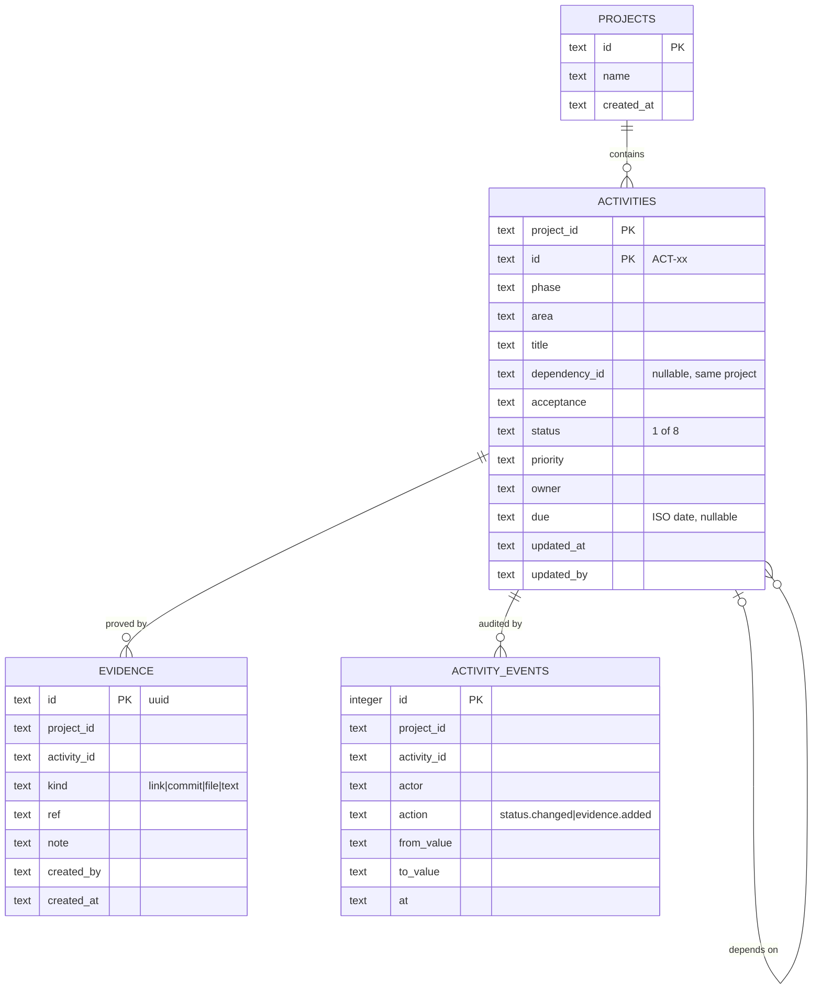

# 06 — Data Model v0.1

- Activity: **ACT-06** · depends on ACT-05
- Status: **DRAFT — awaiting review.** Implemented in `src/server/db/schema.ts`, migration `migrations/0000_init.sql`.

## Entities

Activities also store the static workbook columns `objective`, `tutorial`, `knowledge`, `tool`, `deliverable`, `reference`, `notes`.

## Design decisions

- **Composite key `(project_id, id)`** keeps the stable workbook ID `ACT-xx` and allows multiple projects later (D-007).
- **Derived values are not stored.** `effectivelyDone`, `dependencySatisfied`, `flag`, progress and gates are computed by `src/domain/governance/rules.ts` on every read (14–100 rows; cheap). This prevents stale counters.
- **Evidence count drives completion.** The workbook `Evidence` text column becomes zero or more `evidence` rows (imported as kind `text`).
- **Audit log is append-only.** No update/delete paths exist for `activity_events`.
- **Enums in code, not in SQL.** SQLite has no enum type; Zod and domain types enforce values.
- **Dates as ISO-8601 text.** Due dates `YYYY-MM-DD`; timestamps full ISO UTC.

## Requirement coverage

| Requirement | Entity / field |
| --- | --- |
| DR-01 workbook attributes | `activities.*` |
| DR-02 evidence | `evidence` |
| DR-03 audit | `activity_events` |
| DR-04 project | `projects`, `activities.project_id` |
| DR-05 vocabularies | `src/domain/governance/types.ts` (code), fixture `statuses/priorities/areas/phaseArea` |
| FR-12 actor/time/from/to | `activity_events.actor/at/from_value/to_value`, `activities.updated_by/updated_at` |

## Open points

- Evidence file storage (R2) and retention (D-008).
- Optimistic concurrency (`rev` column) before multi-user use.
- Foreign key from `evidence`/`activity_events` to `activities` (composite) — omitted for now; added when D-007 is decided.
