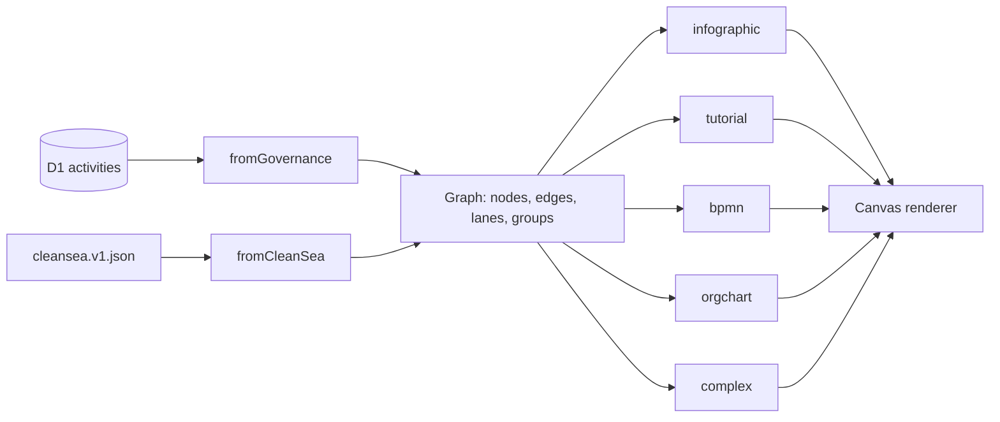

# ADR-003 — Canvas Multiview

- Status: **PROPOSED — implemented locally, awaiting owner approval**
- Date: 2026-11-12 · Source: `reference/loop-design/ADR-003 — Arquitetura Visual Multiview.md`

## Decision

One **universal graph** and five **pure projectors** (`src/domain/diagram`).

- `Graph` = `nodes` (start, end, process, decision, document, person, group) + `edges` (flow, dependency, hierarchy, association) + `lanes` + `groups`.
- Each projector returns placements, hidden IDs, shown edges, decorations and warnings. It never copies or changes node data.
- **Invariant (tested for 5 views × 2 datasets):** placed ∪ hidden = all node IDs; shown edges ⊂ graph edges; graph unchanged after projection; no overlapping boxes.
- When a view cannot show some data, it shows a warning and, if needed, an alternative (for example, Governance has no people → org chart Projeto → Área → Atividade).

## The five views

| View | Governance | Clean Sea | Source intent |
| --- | --- | --- | --- |
| Infográfico | 6 area columns (14 phases exceed 7 columns) with "x/y concluídas" | 6 phase columns with gaps count | "Como trabalhamos" infographic (file not provided: uses real activities) |
| Tutorial | 14 steps, prev / next / restart | 17 steps | "Método LOOP" tutorial (file not provided) |
| BPMN | Lanes = areas, columns = phases, start/end events | Lanes = responsibility, columns = phases A–F, gateway S10 | Clean Sea BPMN |
| Organograma | Alternative hierarchy (warning: no people) | Founders → teams → people | Org chart (image not provided: people from prototype) |
| Diagrama complexo | All 21 nodes, 33 edges | All 33 nodes, all edges incl. inferred | Integrated view |

## Data contracts

- `src/domain/diagram/model.ts` — `Graph`, `DiagramNode`, `DiagramEdge`, `validateGraph`.
- `src/domain/diagram/cleansea.ts` — Zod schema of the extracted fixture.
- Inferred links (owner text → person, task text → document) are flagged `inferred: true` and drawn dashed.

## Acceptance

- GIVEN a loaded model, WHEN the view changes, THEN data and relations MUST stay consistent — `tests/unit/diagram.test.ts`, `tests/e2e/canvas.spec.ts`. ✅
- Each component MUST have contextual metanotes — `tests/unit/design-system.test.ts` (every `data-component-id` exists in the registry and adopted entries have 7-field metanotes). ✅
- Sidebars MUST be collapsible and resizable. ✅
- Prototype MUST work with local data — Clean Sea fixture is local; Governance uses the local D1. ✅
- Five views, reusable library, documented contracts. ✅

> **Update 2026-11-14 (ADR-008):** the static CleanSea dataset (`data/reference/cleansea.v1.json`) moved to `clients/prj-01-cleansea/reference/`. Canvas datasets are now the current project's governance activities plus its models (DIAG/ORG/FLW).
