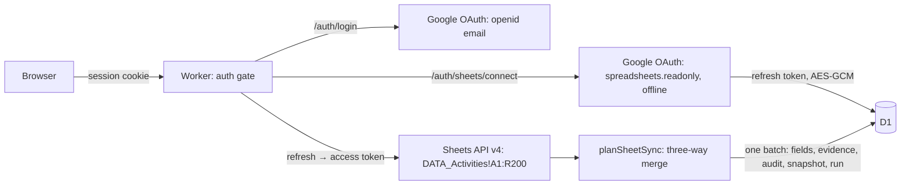

# ADR-005 — Google login and Google Sheets → app synchronization

- Status: **ACCEPTED by owner (session 2026-11-12)**: login with Google + allow-list; sync automatic on open by default, with a preview + apply toggle.
- Related: D-006 (auth, now resolved), ACT-10 (security), ACT-12 (deploy).

## Context

The governance workbook lives in Google Sheets (`DATA_Activities`). The owner edits it there and wants the app to show the changes without code changes or redeploys. The app had no authentication, so it could not be published (D-006).

## Decision

### Authentication
- Google OAuth 2.0 authorization code + PKCE (S256), state in a signed 10-minute cookie.
- Only verified e-mails in the `ALLOWED_EMAILS` secret get a session (HMAC-signed cookie, HttpOnly, Secure, SameSite=Lax, 7 days). The list is checked on every request.
- Production fails closed: missing secrets → 503 for APIs, `/login` explains what is missing (names only).
- Development without Google secrets → local bypass (actor `local-dev`, fixture spreadsheet). A partial Google setup is treated as misconfigured, never as bypass.
- Actor of every mutation = signed-in e-mail; `X-Actor` is ignored when logged in.

### Sheets access
- Separate, incremental consent for `spreadsheets.readonly` with `access_type=offline`. Least privilege: login alone never grants Sheets access.
- The refresh token is encrypted with AES-GCM (`TOKEN_ENCRYPTION_KEY`) in D1 and never sent to the browser. Access tokens are short-lived and not stored.
- The app never writes to the spreadsheet.

### Synchronization (three-way, per field)
| Sheet vs app vs last read (base) | Result |
| --- | --- |
| sheet = app | nothing |
| no base, or app = base | sheet changed → apply |
| sheet = base | only app changed → keep app |
| all different | conflict: never automatic; preview mode lets the user choose |

- Fields: Status, Priority, Owner, Due, Notes. Evidence is additive (a new value creates an evidence record; nothing is deleted) and must pass the evidence rules.
- Modes: **auto** (default) reads on opening `/dashboard` (max every 30 s; "Recarregar dados" forces) and `/sheets`; **preview** shows the plan and applies only on "Aplicar no app".
- Each read writes a `sync_runs` row; each applied change writes an audit event with actor `<email> (sheets auto|sheets)`.

## Consequences
- The owner must add the redirect URI to the OAuth client and, if the consent screen is in *Testing*, add the allowed accounts as test users. In *Testing*, Google expires refresh tokens after 7 days → reconnect weekly or publish the consent screen / use an *Internal* Workspace app.
- The OAuth client secret was shared through the chat upload; rotating it after setup is recommended.
- Rows added to the sheet are not created in the app (`unknownIds` reported); IDs stay stable.

## Verification
`tests/unit/sheet-sync.test.ts`, `tests/unit/auth.test.ts`, `tests/integration/sheets-auth.test.ts` (OAuth callback with fake Google, allow-list, forged state, revocation, encrypted token, three-way sync, conflicts, invalid cells), `tests/e2e/sheets.spec.ts` (criterion G in both modes).
