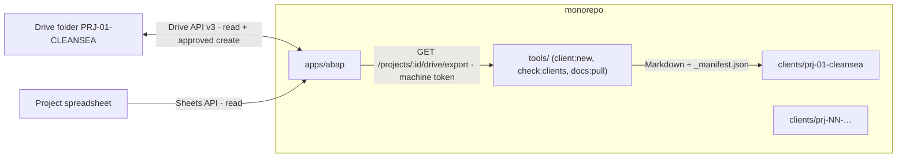

# ADR-006 — Monorepo, one project per client, Google Drive integration

- Status: **ACCEPTED by owner (session 2026-11-14)**: clients as folders in the monorepo; Drive read **and write** through ABAP; client spreadsheets use the governance model.
- Related: D-007 (multi-project, now resolved), ADR-005 (Google login and Sheets), D-020 (no Google IDs in Git).

## Context

ABAP becomes the consultancy's services platform. Each client receives a Google Drive folder (`PRJ-NN-NAME`) with the project spreadsheet and documents. The consultancy turns those documents into structured documentation and then code, with Claude Code.

## Decision

1. **Monorepo** (npm workspaces): `apps/abap` (platform), `clients/<slug>` (one per client, `@clients/<slug>`), `packages/` (shared code, empty until needed), `tools/`. Root `CLAUDE.md` + one `CLAUDE.md` per client from `tools/client-template/`.
2. **Projects** in ABAP: one per client, `id` = client slug. Each project has its own 14 activities, spreadsheet link, sync mode, Drive folder link and audit log (`project_events`). Current project = `?project=` or the `gs_project` cookie.
3. **Drive**: one Google connection (the account in Settings) with scopes `spreadsheets.readonly` + `drive`. Reads: folder tree (3 levels), Google Docs exported as Markdown. Writes: **create a new Google Doc** in the project folder only, with explicit confirmation; never overwrite or delete; audited.
4. **Repository mirror**: `npm run docs:pull -w @clients/<slug>` calls ABAP with a read-only **machine token** (`ABAP_API_TOKEN`), writes Google Docs as Markdown to `clients/<slug>/docs/drive/` with `_manifest.json`. Files carry a hashed key, not the Drive ID; Drive URLs inside documents are omitted; content with credentials is refused.
5. **IDs**: Drive folder and spreadsheet IDs live in D1 (`projects`), never in Git; `check:clients` scans client folders in CI.

## Consequences
- `drive` is a **restricted** Google scope. It works while the OAuth app is in *Testing* (test users). Publishing the app with this scope requires Google's verification and a security assessment. Alternative later: `drive.file` + Google Picker (narrower, but files must be opened/created by the app).
- The connected account must have access to each client folder.
- The machine token can only `GET` project and Drive export/list endpoints; anything else returns 403.
- Single Google connection for all clients: fine for one consultancy account; per-client connections would need a new design.
- Write is limited to creating documents; updating or deleting client files is out of scope until needed.

## Verification
`tests/unit/projects.test.ts`, `tests/integration/projects.test.ts`, `tests/integration/drive.test.ts` (fake Google: tree, export, confirmed write + audit, spreadsheet detection, scope missing, machine token allow/deny), `tools/test/lib-drive.test.mjs` (mirror safety), `tests/e2e/projects.spec.ts`.
