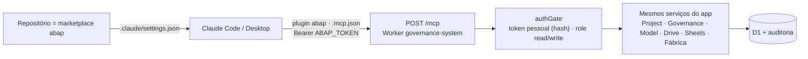

# ADR-009 — MCP endpoint, personal tokens, `abap` plugin and team marketplace

- **Status:** ACCEPTED (owner request and plan approval, 2026-11-15)
- **Related:** ADR-005 (auth), ADR-006 (monorepo, clients), ADR-008 (models)

## Context
The owner asked for a standard way for Claude to operate ABAP: "um plugin com endpoint MCP para Cloudflare e marketplace para que eu use e padronize a integração". Owner decisions: the MCP may do **every write the app does**; each person authenticates with a **personal token**; the 12 supplied plugins are **copied** into the marketplace.

## Decision

1. **Same Worker, stateless MCP.** `POST /mcp` uses `@modelcontextprotocol/sdk` (Streamable HTTP, JSON responses, one server per request). No Durable Objects: every tool is request/response. One deploy, one D1, domain rules not duplicated.
2. **Personal API tokens** (`api_tokens`, migration 0004): `abap_` + 256 random bits, shown once, only the SHA-256 hash stored, role `read | write`, revocable with immediate effect (looked up on every request). Created and revoked in **Settings → Tokens de API** by signed-in users only. The legacy `ABAP_API_TOKEN` keeps working as **read**.
3. **25 tools `abap_*`** (27 since ADR-011: `abap_studio_list`, `abap_studio_publish`) call the same services as the app. Guardrails enforced on the server, not in the prompt:
   - a `read` token cannot call write tools;
   - `DONE` and `VERIFIED` are refused (the owner sets them, with evidence);
   - `abap_drive_create_document` requires `confirm: true` and only creates new documents;
   - every write records `token:<name> (<owner>)` as actor;
   - no delete tools.
4. **REST with a token** stays on the read allow-list (`docs:pull`, `models:pull`, `plugin:pull`). Token writes go through `/mcp` only.
5. **Plugin `abap`** (`plugins/abap`): MCP config with `${ABAP_TOKEN}` from the environment (never in Git), skill `abap-workflow`, commands `/abap-status`, `/abap-diagnostico`, `/abap-sync`.
6. **Marketplace = this repository** (`.claude-plugin/marketplace.json`): `abap`, client agents (`abap-<slug>`, ADR-010) and the 12 vendor plugins in `plugins/vendor/` copied as received, each with `NOTICE.abap.txt` (origin, licence). `.claude/settings.json` registers the marketplace and enables the default stack for everyone who opens the repository.

## Vendor plugins: what is enabled by default
| Enabled by default | Why |
|---|---|
| abap, agent-engineering, backend-design, senior-engineering-partner, modern-web-guidance, agent-handoff, ai-firstify | Skills only, or local hooks reviewed on 2026-11-15 (no network) |

| Available, not enabled | Why |
|---|---|
| expo, prisma, github, engineering, customer-support, cowork-plugin-management | Not part of this stack, or they add external MCP servers that need each person's credentials |

Four packages have **no licence file** (ai-firstify, engineering, prisma, github): internal use only until the licence is confirmed.

## Consequences
- Production needs migration 0004 + deploy (owner approval). Each person then creates a token.
- Rotation: revoke and create a new token. Lost laptop = revoke.
- OAuth (Google) for claude.ai connectors is a possible later step; the tool layer does not change.
- Updating a vendor plugin = replace its folder and bump the version in the marketplace.
