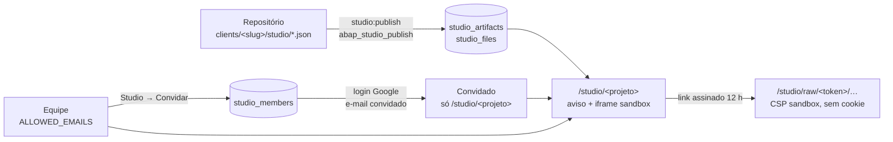

# ADR-011 — Project studio: a shared area with the client, by invitation

- **Status:** ACCEPTED (owner request, 2026-11-15). Production needs migration 0007 + deploy (owner approval).
- **Related:** ADR-005 (Google login, allow-list), ADR-006 (one project per client), ADR-007 (one design system), ADR-009 (MCP), CleanSea ADR-013 and ADR-014.

Each client project gets a **Studio**: an area that the consultancy and **invited** client people share. The first artifact is the CleanSea mobile prototype.

## Context
- The owner asks: publish the CleanSea prototype in ABAP, inside a **studio area of the client project**, shared between the owner and the client, **with access, logins and invitations**; formalise it as a decision and workflows.
- Today access is all-or-nothing: an e-mail in `ALLOWED_EMAILS` sees every project, governance, Drive links and tokens (ADR-005). A client must not see that.
- The prototype is a static HTML + JS bundle (≈ 2 MB) that loads React and Babel from unpkg.com. It is third-party design material: it must not run with the app's session (ADR-007 also forbids mixing its styles into the ABAP UI).

## Decision
1. **Two kinds of people.** *Staff* = `ALLOWED_EMAILS` (unchanged, full access). *Guests* = people invited to a project studio (`studio_members`, migration 0007). A guest signs in with Google (same OAuth flow) and reaches **only** `/studio/<project>` and `GET /api/v1/studio/<project>` of the projects that invited them. Every other path answers 403 (API) or redirects to their studio. The check runs on every request, so revocation is immediate.
2. **Invitations are human-only.** Staff invite and revoke in the app (Studio → Membros) or by the session API. No MCP tool and no token path can grant access (same rule as project deletion, D-036). A staff e-mail cannot be invited. Rows are never deleted: `invited → active` on first sign-in, `→ revoked` with who and when. Every change writes `project_events` in the same batch.
3. **Artifacts** are static text files (html, js, css, json, svg, md, txt) stored in D1 (`studio_files`, ≤ 1.9 MB per file, ≤ 8 MB per artifact), with a **mandatory notice** shown above the artifact. Publishing replaces all files atomically and bumps the revision; identical content creates no revision. Publishing by Claude goes through MCP `abap_studio_publish` (write token) via `npm run studio:publish -w @clients/<slug>`, which reads `clients/<slug>/studio/*.json`.
4. **Isolation.** The artifact is shown in `<iframe sandbox>` and served from `/studio/raw/<signed token>/<path>` with `Content-Security-Policy: sandbox …` (opaque origin: no cookies, no app API with credentials, no top navigation). The token (HMAC with `SESSION_SECRET`, 12 h) is the only access check on that path, because a sandboxed frame sends no cookie. Scripts may load from unpkg.com and cdn.jsdelivr.net only. `Access-Control-Allow-Origin: *` without credentials lets the artifact fetch its own files.
5. **Project deletion** also deletes the studio rows (`PROJECT_TABLES`).

## Options
| Option | Fit | Why not |
|---|---|---|
| A. Studio in ABAP with guest roles (chosen) | High | — |
| B. Separate static Worker per prototype, public URL | Medium | No login, no invitations; the link leaks |
| C. Add clients to `ALLOWED_EMAILS` | Low | Clients would see governance, Drive and tokens of every project |
| D. Cloudflare Access in front of a static site | Medium | Second access system to manage; not inside the client project |

## Consequences
- Easier: one place to show work to the client, with an audit trail.
- Harder: two access levels to test on every new route. `guestMayAccess` is an allow-list: a new route is closed to guests by default (tested).
- Guests must have a Google account for the invited e-mail. No e-mail is sent by ABAP: staff share the login link.
- Revisit: when artifacts need binary files (images) → R2; when a guest needs to comment or upload → new ADR.

## Verification
- `tests/unit/studio.test.ts` (access rules, path traversal, publish validation) and `tests/integration/studio.test.ts` (invite → sign-in → read-only studio → 403 elsewhere → revoke; signed link served sandboxed without cookie; forged and expired tokens refused; deletion cleans studio rows).
- Browser check 2026-11-15 (local): the CleanSea prototype renders in the studio frame; the frame cannot read cookies ("sandboxed and lacks allow-same-origin").
