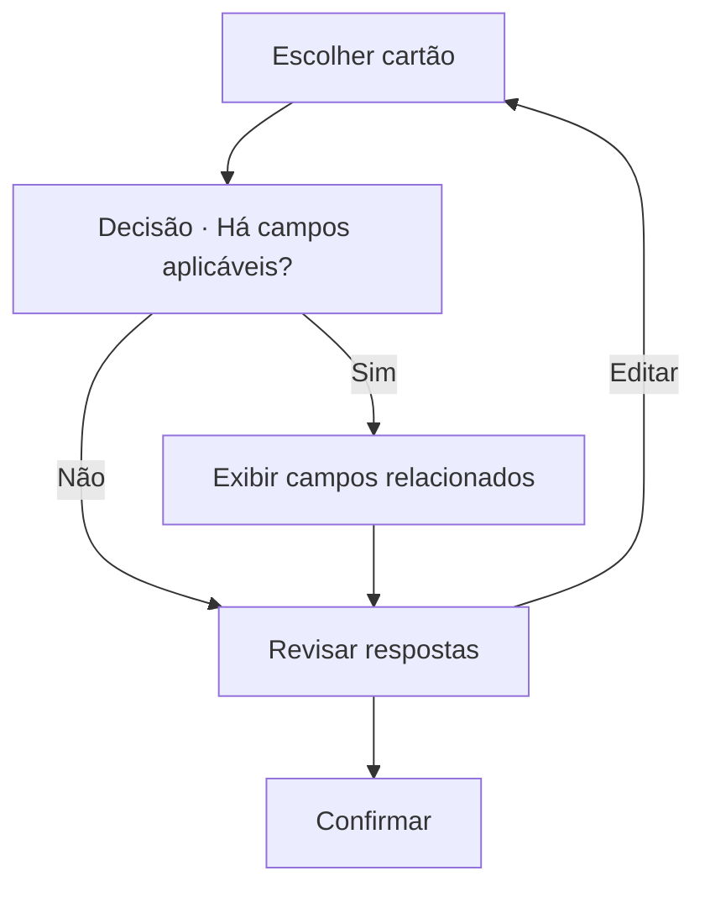

# ADR-UIX-001 — Gestalt, Whitespace e Hierarquia Visual

| Campo | Registro |
| --- | --- |
| README de engenharia | [Stack e índice de ADRs](../../README.md#adr-index) |
| Status da proposta de interface | **PROPOSED** |
| Versão | 1.1 |
| Data | 2026-11-15 |
| Escopo | Documentação de engenharia do ABAP e questionário adaptativo |

## Visão geral

A proposta combina proximidade de Gestalt, escala modular de espaçamento e cartões de seleção para tornar cada grupo, pergunta e ação principal fácil de identificar. A lógica condicional determina quais perguntas aparecem.



A seleção atualiza a resposta e o estado visual do cartão. Se a regra exigir campos adicionais, o formulário os apresenta antes da revisão. Na revisão, o usuário pode voltar, corrigir e confirmar as respostas.

## Visual-first

O README de engenharia registra o stack e o índice de decisões. A versão 1.1 aplica o seguinte fluxo aos novos ADRs e às revisões no diretório do app.

| Regra | Aplicação |
| --- | --- |
| **DOC-01 · README primeiro** | Ao criar ou revisar um ADR, o autor MUST atualizar seu registro no topo de [`apps/abap/README.md`](../../README.md#adr-index) antes de redigir a descrição. Informe ID, link, status, versão quando houver e impacto. Se a decisão afetar o stack, registre a camada, o status e a evidência. Se reutilizar o stack atual, indique isso na linha do ADR. |
| **DOC-02 · Descrição rastreável** | O ADR MUST apontar para a entrada no README acima da descrição e usar o mesmo ID, status e versão. Quando a mudança for integrada, os dois documentos MUST estar na mesma alteração. Atualize os dois registros quando o status mudar. |
| **DOC-03 · Visão geral e detalhes** | O documento MUST abrir com a decisão, seu efeito e uma visão geral. Use um diagrama quando arquitetura, dependências, causa e efeito, decisões ou fluxo de dados se tornarem mais claros. Use tabelas para correspondências e valores exatos. Coloque detalhes extensos sob títulos ou em seções expansíveis identificadas. |
| **DOC-04 · Integridade e dados** | Ao reformatar, o autor MUST preservar requisitos, IDs, condições, exceções, unidades, precisão, exemplos, referências e histórico. Use schemas, manifestos, tokens e ADRs versionados como fontes. Reutilize os mesmos dados validados nas vistas. Diferencie decisões, hipóteses e evidências de implementação. |
| **DOC-05 · Acessibilidade** | O conteúdo essencial, as condições de decisão e os riscos em aberto MUST ser legíveis em texto ou tabela. Use títulos semânticos, rótulos claros, contraste e estados perceptíveis sem depender só da cor. Controles interativos MUST operar por teclado e ter foco visível. Quando houver tema do produto, use seus tokens oficiais. |
| **DOC-06 · Contexto, entrega e melhoria** | Reaproveite os arquivos e as convenções do projeto antes de pedir informação repetida. Na entrega, mostre a alteração, o motivo, a verificação e as pendências. Mantenha a visão executiva curta e os detalhes técnicos acessíveis. Corrija falhas recorrentes na fonte e documente a solução como skill, regra ou teste reproduzível. |

Use Mermaid para fluxos e dependências em Markdown. Use SVG para um visual estático que precise de controle de layout. Uma prévia HTML ou demonstração interativa MAY complementar o documento quando houver uma interação, simulação ou comparação que o leitor precise explorar. Mantenha a leitura essencial disponível no próprio documento.

| Verificação documental | Critério de aceitação |
| --- | --- |
| Sequência e vínculos | **DADO** um ADR novo ou revisado, **QUANDO** o autor iniciar o registro, **ENTÃO** atualiza o índice do README primeiro. Na revisão da mudança, os links relativos resolvem, o vínculo de retorno precede a descrição e os campos coincidem. |
| Rastreabilidade do stack | **DADO** o impacto declarado, **QUANDO** a alteração for revista, **ENTÃO** a opção proposta está identificada pelo status e o stack configurado aponta para evidência do repositório. |
| Integridade da reformatação | **DADO** um documento anterior, **QUANDO** ele for reorganizado, **ENTÃO** cada requisito, condição, exceção, valor, exemplo e referência pode ser localizado na nova estrutura. |
| Leitura da visão geral | **DADO** o documento em uma tela estreita ou sem o diagrama, **QUANDO** o leitor consultar a decisão, **ENTÃO** encontra suas condições e referências. Se houver painel expansível, o teclado abre o conteúdo e o foco continua visível. |

## Contexto do questionário

| Elemento | Evidência e estado |
| --- | --- |
| Cartões e seleção | [`ChoiceCard` e `CardSelectionGroup`](../../src/components/patterns/choice-card.tsx) estão implementados. O grupo usa radio para seleção única e checkbox para múltipla, com `fieldset` e `legend`. Espere foco visível, marca de seleção, borda e feedback de erro associado. |
| Questionário adaptativo | A [especificação do padrão](../design/adaptive-card-questionnaire.md) registra **PLANNED** para o questionário adaptativo ligado à coleta das cinco entrevistas de ACT-02. |
| Interface e dados | O [ADR-008](adr-008_interface-templates-project-models.md) define o contrato de templates e modelos de projeto. Use dados validados e regras de adaptação versionadas para gerar as vistas. |
| Identidade visual | O [ADR-007](adr-007_single-design-system-bundle.md) define o bundle ABAP. Consulte a [fonte de tokens](../design-system/DESIGN_TOKENS.json) para mapear a proposta ao tema e aos componentes existentes. |

## Decisão de interface

Adotar **Gestalt Proximity + Modular Spacing Scale + Adaptive Card-Based Questionnaire**. Usar uma escala em múltiplos de 4 px, com 8 px como unidade principal, para expressar hierarquia e agrupamento.

| Intenção | Regra local | Aplicação |
| --- | --- | --- |
| Agrupar itens relacionados | `D_inter ≥ 2 × D_intra` | `D_inter` mede a distância entre grupos e `D_intra` a distância entre itens do grupo. Esta heurística deve ser verificada no nível de agrupamento em análise. |
| Isolar um destaque | `S_destaque = k × S_grupo`, com `1,5 ≤ k ≤ 2,0` | `S_grupo` é o espaço de referência. Amplie o espaço ao redor do destaque e mantenha sua associação semântica com o grupo. |

Por exemplo, uma distância interna de 16 px pede pelo menos 32 px entre grupos. Um destaque com espaço de referência de 24 px pode usar 48 px quando `k = 2`.

| Token de referência | Valor | Uso |
| --- | ---: | --- |
| `space-1` | 4 px | Microelementos |
| `space-2` | 8 px | Ícone e texto |
| `space-3` | 12 px | Conteúdo interno |
| `space-4` | 16 px | Cartões relacionados |
| `space-6` | 24 px | Subgrupos |
| `space-8` | 32 px | Perguntas |
| `space-12` | 48 px | Seções |
| `space-16` | 64 px | Destaques |

## Requisitos de interface

| ID | Prioridade | Requisito |
| --- | --- | --- |
| UIX-001 | MUST | Usar tokens de espaçamento. |
| UIX-002 | MUST | Agrupar semanticamente títulos, perguntas, opções e mensagens relacionadas. |
| UIX-003 | MUST | Distinguir grupos por espaçamento e hierarquia. |
| UIX-004 | MUST | Comunicar a seleção em estado visual e semântico, com um indicador além da cor. |
| UIX-005 | MUST | Permitir navegação e operação por teclado, com foco visível e ordem lógica. |
| UIX-006 | MUST | Exibir os campos condicionais aplicáveis à resposta atual. |
| UIX-007 | SHOULD | Usar cartões para apresentar as opções de seleção. |
| UIX-008 | SHOULD | Manter a ação principal identificável. |
| UIX-009 | SHOULD | Minimizar mudanças inesperadas de posição ou de foco. |
| UIX-010 | MAY | Adaptar o espaçamento ao tamanho da tela, preservando agrupamento e ordem de leitura. |

## Arquitetura de componentes

| Componente pai | Elementos da proposta |
| --- | --- |
| `AdaptiveOnboardingFlow` | `ProgressIndicator`, `FormSection`, `SectionHeading`, `QuestionGroup`, `ValidationFeedback` e `NavigationActions` |
| `QuestionGroup` | `QuestionLabel`, `CardSelectionGroup` e `ConditionalFields` |
| `CardSelectionGroup` | `ChoiceCard` |

| Evento | Resposta esperada |
| --- | --- |
| Selecionar cartão | Atualizar o estado visual e semântico. |
| Alterar resposta anterior | Recalcular os campos aplicáveis e permitir a revisão das respostas. |
| Reduzir a largura da tela | Reorganizar os cartões e preservar a ordem lógica. |
| Detectar erro de preenchimento | Mostrar mensagem associada à pergunta. |

<details>
<summary>Implementação CSS de referência</summary>

O exemplo registra os valores da proposta original. No ABAP, mapeie cores e espaçamentos para os tokens do bundle. O contorno de foco no componente existente acompanha o foco do input nativo.

```css
:root {
  --space-1: 4px;
  --space-2: 8px;
  --space-3: 12px;
  --space-4: 16px;
  --space-6: 24px;
  --space-8: 32px;
  --space-12: 48px;
  --space-16: 64px;
}

.question-group {
  display: flex;
  flex-direction: column;
  gap: var(--space-4);
}

.form-section {
  display: flex;
  flex-direction: column;
  gap: var(--space-8);
}

.form-section + .form-section {
  margin-block-start: var(--space-12);
}

.choice-grid {
  display: grid;
  grid-template-columns: repeat(2, minmax(0, 1fr));
  gap: var(--space-4);
}

.choice-card {
  min-height: 44px;
  padding: var(--space-4);
  border: 1px solid var(--border);
  border-radius: 12px;
}

.choice-card:focus-visible {
  outline: 2px solid var(--focus);
  outline-offset: 2px;
}

@media (max-width: 600px) {
  .choice-grid {
    grid-template-columns: 1fr;
  }
}
```

O tema do exemplo fornece `--border` e `--focus`. O estado de seleção requer também os sinais visuais e a semântica descritos em UIX-004.

</details>

## Verificação do questionário

| ID | Verificação | Resultado esperado |
| --- | --- | --- |
| TEST-001 | Inspeção automatizada de espaçamento | Os valores medidos correspondem a tokens e as distâncias respeitam os agrupamentos especificados. |
| TEST-002 | Teste de percepção | Os usuários distinguem os grupos e identificam a ação principal com os rótulos, disposição e espaçamento disponíveis. |
| TEST-003 | Operação por teclado | Selecionar, revisar e avançar funciona sem mouse. |
| TEST-004 | Estado acessível da seleção | A descrição dos controles comunica a seleção e a interface tem sinal visual além da cor. |
| TEST-005 | Integração da lógica condicional | Apenas os campos aplicáveis ficam disponíveis conforme a regra vigente. |
| TEST-006 | Teste em tela estreita e larga | Os cartões se reorganizam e preservam a ordem lógica e a legibilidade. |
| TEST-007 | Ordem de foco | O foco permanece visível e segue ordem lógica, inclusive após revelar ou ocultar campos. |

**DADO** um conjunto de grupos, **QUANDO** o usuário ler e avançar pelo questionário, **ENTÃO** distingue os grupos e identifica a ação principal mesmo sem usar a cor como pista.

**DADA** uma resposta que ativa campos condicionais, **QUANDO** o usuário escolher outra opção, **ENTÃO** apenas os campos da condição atual ficam disponíveis e as respostas aplicáveis ficam acessíveis na revisão.

A aprovação da proposta requer os MUST implementados e os testes críticos aprovados. Avalie os critérios aplicáveis de [WCAG 2.2 AA](https://www.w3.org/TR/WCAG22/). Revise o ADR com o resultado dos testes do questionário.

## Alternativas e consequências

| Opção da v1.0 | Decisão na proposta | Motivo |
| --- | --- | --- |
| Espaçamentos arbitrários | Rejeitada | Enfraquecem consistência e reutilização. |
| Separadores visuais em todos os grupos | Rejeitada | Aumentam ruído e repetem sinais de agrupamento. |
| Whitespace como único sinal | Rejeitada | Títulos, estados e semântica também informam a hierarquia. |
| Escala modular, Gestalt, whitespace e hierarquia | Selecionada para validação | Torna agrupamentos mais claros e facilita manutenção de componentes. |

| Risco | Verificação ou mitigação |
| --- | --- |
| Maior rolagem em telas pequenas | Testar o fluxo em tela estreita e aplicar tokens adequados ao agrupamento. |
| Separação excessiva de itens relacionados | Testar associação entre título, pergunta, opções e feedback. |
| Omissão indevida de pergunta | Validar as condições com respostas que ativam e desativam cada ramo. |
| Deslocamento inesperado do conteúdo ou foco | Testar transições, revisão de respostas e ordem de foco. |

<details>
<summary>Fontes e histórico</summary>

| Fonte | Referência |
| --- | --- |
| Padrão de formulário e exemplo original | [Adaptive Card-Based Questionnaire](../../reference/loop-design/Adaptive%20Card-Based%20Questionnaire.md) |
| Design do ABAP | [Design system](adr-007_single-design-system-bundle.md), [regras de diagramas](../design/diagramming-system.md) e [instruções de engenharia](../../../../docs/global-instructions.md) |
| Gestalt | Proximidade, similaridade e região comum |
| Nielsen Norman Group | Hierarquia visual e [Progressive Disclosure](https://www.nngroup.com/articles/progressive-disclosure/) |
| Material Design | Layout e espaçamento |
| W3C | [WCAG 2.2](https://www.w3.org/TR/WCAG22/) |
| ISO | [ISO 9241-110](https://www.iso.org/standard/75258.html), princípios de interação, e ISO 9241-210, design centrado no ser humano |
| GitHub | [Diagramas Mermaid](https://docs.github.com/en/get-started/writing-on-github/working-with-advanced-formatting/creating-diagrams) e [seções expansíveis](https://docs.github.com/en/get-started/writing-on-github/working-with-advanced-formatting/organizing-information-with-collapsed-sections) |

| Versão | Alteração |
| --- | --- |
| 1.0 | Proposta original de hierarquia visual, espaçamento e questionário adaptativo. |
| 1.1 | Registra a proposta no repositório e aplica a regra README primeiro e o padrão visual-first. Mantém os critérios de aprovação da proposta de interface. |

</details>
