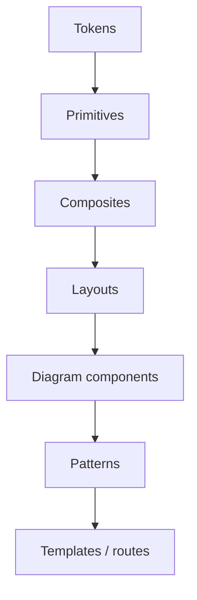

# Component Taxonomy (ADR-004 G2)

Six families, ordered by dependency. A component may depend only on its own family or families above it.

| Family | Rule | Adopted components (registry IDs) |
| --- | --- | --- |
| **Foundations** | Values, no behaviour | `tokens-color`, `tokens-type`, `tokens-space`, `icons` |
| **Primitives** | One element, one job | `button`, `badge`, `status-badge`, `flag-badge`, `progress-bar`, `input`, `toggle`, `tooltip`, `separator` |
| **Composites** | Primitives combined for one task | `card`, `tabs`, `view-toggle`, `choice-card`, `card-selection-group`, `stepper`, `metanote-panel` |
| **Layouts** | Regions of a screen | `app-shell`, `canvas-workspace`, `resizable`, `sidebar-library`, `inspector`, `context-bar` |
| **Diagrams** | Diagramming system (square geometry) | `diagram-node`, `diagram-edge`, `lane-band`, `phase-frame`, `bpmn-event` |
| **Patterns** | Complete solutions to a user goal | `pattern-dashboard`, `pattern-multiview`, `pattern-tutorial`, `pattern-adaptive-questionnaire` (planned) |

Classification axes kept in the registry: function, variants, states, dependencies, usage (where it appears) and status (`adopted`, `available`, `planned`).

