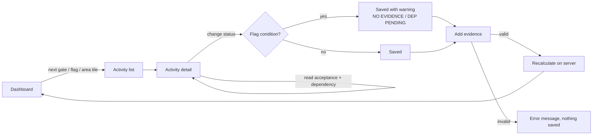

# 04 — User Flows and Key Screens v0.1

- Activity: **ACT-04** · depends on ACT-03
- Status: **DRAFT — awaiting owner review**
- Deliverable deviation: the workbook asks for `04_user-flows_v0.1.pdf`. This Markdown file (with Mermaid diagrams) is the source; export to PDF after review.

## Main flow — complete an activity with evidence

## Key screens

| Screen | Route | Content | State |
| --- | --- | --- | --- |
| Dashboard | `/dashboard` | Overall progress, flags, next gate, 6 area tiles | Implemented |
| Activities | `/activities` | Table: ID, activity, area, dependency, status, evidence, flag; filters | Implemented |
| Activity detail | `/activities/:id` | Fields, acceptance, dependencies, status form, evidence form, evidence list, history | Implemented |
| Evidence | `/evidence` | All evidence, newest first | Implemented |
| Projects | `/projects` | Placeholder (D-007) | Planned |
| Settings | `/settings` | Placeholder (D-006) | Planned |

## Visual language

Tokens come from the workbook sheet `Design Tokens` (`app/app.css`): monochrome surfaces, brand blue `#0F6CBD` for actions and input borders, `#B10E1C` only for blocked/critical states. Status badges follow `status.*` tokens (DONE = solid black, VERIFIED = solid blue, BLOCKED = solid red).

## Accessibility checklist (WCAG 2.2 AA) — to review

| # | Check | Implementation | Reviewed |
| --- | --- | --- | --- |
| 1 | Every form control has a visible label | `<Label htmlFor>` on all inputs | ☐ |
| 2 | Keyboard reachable, visible focus | Native controls; `:focus-visible` outline 2 px brand | ☐ |
| 3 | Skip link to main content | "Skip to content" in root layout | ☐ |
| 4 | Status not conveyed by colour alone | Badges contain text; flags have text + icon | ☐ |
| 5 | Contrast ≥ 4.5:1 for text | Token pairs (e.g. `#115EA3` on `#EBF3FC`) — verify with a checker | ☐ |
| 6 | Progress bars expose values | `role="progressbar"` with `aria-valuenow` | ☐ |
| 7 | Messages announced | Warnings/errors in `role="status"` | ☐ |
| 8 | Tables have headers and caption | `<th scope="col">`, sr-only caption | ☐ |
| 9 | Language declared | `<html lang="en">` — UI text mixes EN labels and PT workbook content; decide language (D-009) | ☐ |
