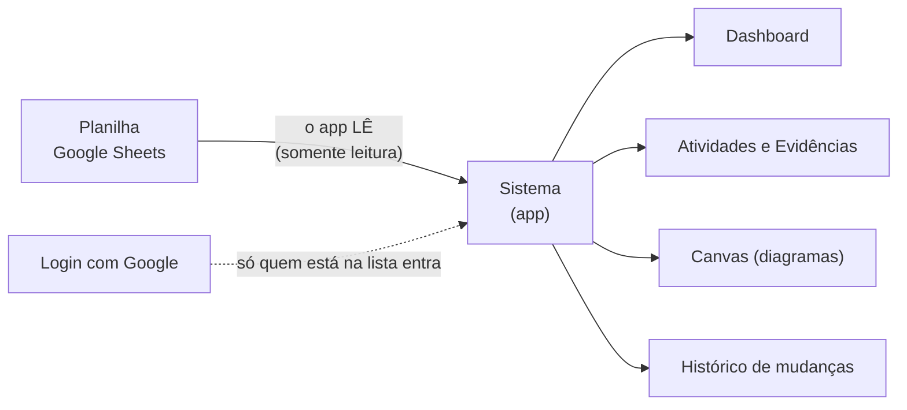

# Guia do time — Planilha e integrações

Este guia explica, em linguagem simples, o que a planilha faz, como ela conversa com o sistema e o que cada pessoa do time pode (e não pode) fazer.

- **Sistema (app):** https://governance-system.contato-adulto-tdah.workers.dev
- **Planilha:** use o link **"Abrir planilha"** na tela **Planilha** do app, ou peça ao administrador.
- **Para quem é:** time de projeto. Não é preciso saber programar.

---

## 1. Em uma frase

Você edita a planilha do Google, e o sistema **lê** essas mudanças e mostra tudo organizado: progresso, alertas, histórico e diagramas. O sistema **nunca escreve** na planilha.

## 2. Como as peças se encaixam

| Peça | Para que serve |
|---|---|
| **Planilha (Google Sheets)** | Lugar onde o time edita Status, Responsável, Prazo, Evidência e Observações das 14 atividades. |
| **Sistema (app)** | Lê a planilha, confere as regras de governança, calcula o progresso e guarda o histórico. |
| **Login com Google** | Controla quem pode abrir o sistema. Só contas da lista autorizada entram. |
| **Cloudflare** | Onde o sistema fica hospedado e onde ficam guardados os dados e os segredos. |
| **GitHub** | Guarda o código e roda testes automáticos a cada mudança. |
| **Assistente Claude** | Pode ler e editar a planilha pelo conector do Google Sheets e ajudar a manter o sistema. Não entra no app. |

---

## 3. Quem pode entrar no sistema

- Só entram as contas Google que o administrador colocou na **lista de acesso**.
- Se alguém sair da lista, perde o acesso imediatamente.
- **Atenção:** quem tem permissão de **editar a planilha** consegue mudar o que o sistema mostra, mesmo sem entrar no sistema. Compartilhe a planilha só com quem deve editar.

---

## 4. O que o sistema lê da planilha

O sistema lê apenas a aba **DATA_Activities**, linhas 1 a 200, colunas **A a R**. Dessas, só **seis colunas** são levadas para o sistema:

| Coluna | Campo | O que escrever |
|---|---|---|
| **M** | Status | Um dos 8 status (veja a seção 5). Escreva exatamente igual. |
| **N** | Priority | `Critical`, `High`, `Medium` ou `Low`. |
| **O** | Owner (responsável) | Nome em texto livre, até 100 caracteres. |
| **P** | Due (prazo) | De preferência `2026-12-31` (ano-mês-dia). Também aceita `31/12/2026`. Vazio = sem prazo. |
| **Q** | Evidence (evidência) | Um link `https://...` ou um texto com pelo menos 10 caracteres. |
| **R** | Notes (observações) | Texto livre, até 2000 caracteres. |

**Não são lidas:** as colunas A a L (descrição da atividade, tutorial, critério de aceite…) e as colunas S a U (fórmulas da própria planilha). As outras abas (Home, Dashboard, abas por área, Guide…) também não entram no sistema.

> **Dica sobre datas:** use `AAAA-MM-DD`. Com `11/12/2026` o sistema entende **dia 11 de dezembro**; uma planilha configurada no formato americano pode confundir dia e mês.

## 5. Os 8 status

| Status | Significado |
|---|---|
| `NOT STARTED` | Ainda não começou. |
| `IN PROGRESS` | Em andamento. |
| `BLOCKED` | Parada por algo externo (explique em Notes). |
| `PREPARED` | Material pronto para começar ou revisar. |
| `IN REVIEW` | Entrega pronta, esperando revisão. |
| `APPROVED` | Revisão aprovada. |
| `VERIFIED` | Critério de aceite conferido. |
| `DONE` | Concluída. **Só conta no progresso se tiver evidência.** |

---

## 6. O que acontece quando você edita a planilha

1. Você muda uma célula (por exemplo, o Status da ACT-03).
2. Alguém abre o **Dashboard** do sistema (ou clica em **Recarregar dados**).
3. O sistema lê a planilha, compara com o que já tem e aplica as diferenças.
4. Um aviso no topo do Dashboard diz quantas alterações foram aplicadas.
5. A mudança aparece nas telas e fica registrada no **histórico** da atividade, com a pessoa e o horário.

Não é preciso mexer em código nem publicar nada de novo.

---

## 7. Dois modos de sincronização

Na tela **Planilha**, há dois botões. O modo escolhido vale para todo o time.

| | **Automático ao abrir** (padrão) | **Prévia + Aplicar** |
|---|---|---|
| Quando lê | Ao abrir o Dashboard ou a tela Planilha | Só quando você abre a tela Planilha |
| Quando grava no app | Na hora, sozinho | Só depois que você clica em **Aplicar no app** |
| Conflitos | Nunca são aplicados sozinhos | Você escolhe, um a um |
| Indicado para | Uso do dia a dia | Revisar antes de mudar o app (por exemplo, antes de uma reunião) |

**Detalhes do automático**
- Para não sobrecarregar, o Dashboard lê no máximo **uma vez a cada 30 segundos**.
- O botão **Recarregar dados** ignora esse intervalo e lê na hora.
- Se a leitura falhar, o Dashboard mostra o motivo e continua exibindo os dados que o sistema já tinha.

---

## 8. Conflitos: quando as duas pontas mudam

Um **conflito** acontece quando o **mesmo campo** foi alterado na planilha **e** no sistema, com valores diferentes, desde a última leitura.

**Exemplo:** a ACT-02 estava `NOT STARTED`. Alguém mudou o status **no sistema** para `IN PROGRESS`. Outra pessoa mudou **na planilha** para `BLOCKED`.

- O sistema **não escolhe sozinho**. Nenhum dos dois valores é perdido.
- Na tela **Planilha**, o conflito aparece numa tabela com o valor do sistema, o valor da planilha e o valor da última leitura.
- Para usar o valor da planilha, marque a caixa **"Usar planilha?"** e clique em **Aplicar no app**.
- Se não marcar, o valor do sistema continua, e o conflito segue visível até alguém decidir.

**Regra de ouro:** uma mudança feita **só no sistema** não é desfeita pela planilha. A planilha só vence quando você manda.

---

## 9. Evidências

Evidência é a prova de que uma atividade está concluída (um link, um documento, um registro).

- A atividade só conta como **concluída** quando o status é `DONE` **e** existe pelo menos uma evidência.
- **Pela planilha:** escreva na coluna **Q** um link `https://...` ou um texto com pelo menos 10 caracteres. O sistema cria um registro de evidência.
- **Pelo sistema:** na tela da atividade, use **Adicionar evidência**. Lá dá para escolher o tipo: link, commit, arquivo ou texto, e cada tipo é conferido (link precisa ser http/https; commit precisa ser um código de 7 a 40 caracteres; arquivo precisa ser um caminho relativo).
- Evidência só **entra**, nunca é apagada: se você trocar o texto da célula Q, o sistema cria **outro** registro e mantém o anterior. Apagar a célula não remove nada.
- Se a evidência da planilha for inválida (por exemplo, um texto muito curto), ela aparece na lista de problemas e **não é gravada**.

---

## 10. O que o sistema avisa (alertas)

O sistema calcula alertas por conta própria. Se mais de um se aplicar, mostra o primeiro desta lista:

| Alerta | Quando aparece |
|---|---|
| **BLOCKED** | O status é `BLOCKED`. |
| **NO EVIDENCE** | O status é `DONE` ou `VERIFIED`, mas não há evidência. |
| **DEP PENDING** | A atividade já começou, mas a atividade da qual ela depende ainda não está concluída. |
| **OVERDUE** | O prazo passou e a atividade ainda não está concluída. |

Os alertas **não impedem** a mudança: o sistema grava e avisa. Assim ele acompanha o que a planilha já faz.

Uma atividade só "libera" a próxima quando está concluída de verdade (`DONE` **com** evidência).

---

## 11. Células com problema

Se alguma célula estiver errada, o sistema **não aplica** aquele valor, **aplica o resto** e lista o problema na tela **Planilha**, em "Células inválidas". Exemplos:

| O que aconteceu | Mensagem |
|---|---|
| Status escrito errado (`FINISHED`, `Done `…) | "must be one of NOT STARTED, IN PROGRESS…" |
| Prioridade fora da lista | "must be one of Critical, High, Medium, Low" |
| Data impossível (`31/02/2026`) | "expected YYYY-MM-DD or DD/MM/YYYY" |
| ID fora do padrão | "ID must be ACT-nn" |
| ID repetido | "duplicate ID: only the first row is used" |

Corrija a célula na planilha e leia de novo.

---

## 12. Telas do sistema

| Tela | Para que serve |
|---|---|
| **Dashboard** | Progresso geral, progresso por área, alertas e o próximo passo. Mostra o resultado da última leitura da planilha e o botão **Recarregar dados**. |
| **Activities** | Lista das 14 atividades com filtro por área e por alerta. Ao abrir uma atividade: objetivo, critério de aceite, dependências, mudar status, adicionar evidência e histórico. |
| **Canvas** | Diagramas das atividades em 5 formas: Infográfico, Tutorial, BPMN, Organograma e Diagrama complexo. Só leitura. |
| **Evidence** | Todas as evidências registradas, da mais nova para a mais antiga. |
| **Planilha** | Fonte, data da última leitura, modo de sincronização, prévia das mudanças, conflitos e células inválidas. |
| **Design system** | Catálogo dos componentes visuais do sistema (para quem mantém o produto). |
| **Settings** | Quem está logado, quem tem acesso, conexão com a planilha e o modo de sincronização. |
| **Projects** | Reservado para o futuro. Hoje há um projeto só. |

**Canvas:** o conjunto de dados "Clean Sea" é um exemplo extraído de um protótipo e está marcado como **não validado**. Ele tem 17 etapas, não as 23 que os documentos citam; não use como fonte oficial.

---

## 13. Quem mudou o quê (histórico)

Toda mudança fica registrada na tela da atividade, com **quem**, **quando**, **de qual valor para qual**. Quem veio da planilha aparece assim:

- `fulano@email.com (sheets auto)`: mudança aplicada automaticamente ao abrir o sistema.
- `fulano@email.com (sheets)`: mudança aplicada manualmente na tela Planilha.
- `fulano@email.com`: mudança feita direto no sistema.

O e-mail é o da pessoa que **abriu o sistema** naquele momento, não de quem editou a planilha.

---

## 14. O que o sistema nunca faz

- **Nunca escreve na planilha.** Se alguém mudar algo só no sistema, a planilha continua com o valor antigo.
- **Nunca cria atividades.** Linhas novas na planilha com IDs que o sistema não conhece são ignoradas (o sistema avisa quais).
- **Nunca apaga evidências nem histórico.**
- **Nunca resolve conflitos sozinho.**
- **Nunca marca uma atividade como concluída por conta própria.** `DONE` só vale com evidência.
- **Nunca lê outras abas** além de DATA_Activities.

> **Combinado sugerido para o time:** edite **status, responsável, prazo, prioridade e observações na planilha**. Use o sistema para acompanhar, adicionar evidências com validação e consultar o histórico. Assim cada campo tem um lugar só.

---

## 15. Limites e cuidados

| Assunto | O que saber |
|---|---|
| **Tamanho** | O sistema lê até a linha 200. Hoje há 14 atividades. |
| **Conexão com o Google** | A conexão com a planilha é feita por uma conta (mostrada em Settings). Essa conta precisa ter acesso à planilha. Se perder o acesso, aparece um erro de leitura. |
| **Validade da conexão** | Enquanto o aplicativo do Google estiver em modo de teste, a conexão **expira a cada 7 dias**. Quando acontecer, clique em **Reconectar Google Sheets** em Settings. |
| **Intervalo de leitura** | Máximo de uma leitura automática a cada 30 segundos no Dashboard. |
| **Idioma** | A tela está em português e inglês misturados; o conteúdo das atividades vem da planilha, em português. |
| **Modo escuro** | Ainda não existe. |

---

## 16. Problemas comuns

| Sintoma | O que fazer |
|---|---|
| Mudei a planilha e o sistema não mudou | Abra o Dashboard e clique em **Recarregar dados**. Confira se o modo é **Automático**; em **Prévia + Aplicar**, é preciso clicar em Aplicar. |
| "Planilha ainda não conectada" | Vá em **Settings → Conectar Google Sheets**. |
| "Falha ao ler a planilha" (erro 403 ou 404) | A conta conectada perdeu acesso à planilha, ou a planilha mudou. Compartilhe de novo ou peça ao administrador. |
| Erro 400 `redirect_uri_mismatch` ao entrar | Endereço de retorno não cadastrado no Google. Avise o administrador. |
| "Access blocked… not completed verification" | A conta não está na lista de **usuários de teste** do Google. Avise o administrador. |
| Funcionava e parou depois de uma semana | A conexão de teste expirou. Use **Reconectar Google Sheets**. |
| "Esta conta Google não está autorizada…" | O e-mail não está na lista de acesso do sistema. Avise o administrador. |
| Uma célula aparece em "Células inválidas" | Corrija o valor na planilha (veja a seção 11). |
| Apareceu um conflito | Resolva na tela **Planilha** (seção 8). |
| A atividade está `DONE` mas o progresso não subiu | Falta evidência. Veja o alerta **NO EVIDENCE**. |

---

## 17. Assistente Claude e o conector do Google Sheets

O assistente Claude desta conta tem um **conector do Google Sheets** próprio. Com ele, o assistente consegue:

- **ler** valores e abas da planilha;
- **escrever** em células (foi assim que o teste do ACT-01 foi feito);
- criar e ajustar fórmulas e abas.

Ele **não** faz login no sistema e **não** altera o sistema diretamente. O sistema só enxerga a mudança na próxima leitura (ao abrir o Dashboard). Combine com o time quando for pedir ao assistente para editar a planilha, porque a edição vale para todos.

---

## 18. Para o administrador

O que fica guardado como **segredo** na Cloudflare (nunca no GitHub): ID e segredo do cliente Google, chave de sessão, chave que protege a conexão com a planilha, a lista de e-mails autorizados e o ID da planilha.

| Tarefa | Como |
|---|---|
| **Dar acesso a uma pessoa** | (1) Colocar o e-mail em **Usuários de teste** no Google Cloud (tela de consentimento OAuth → Público-alvo). (2) Atualizar o segredo `ALLOWED_EMAILS` na Cloudflare, com todos os e-mails separados por vírgula: `npx wrangler secret put ALLOWED_EMAILS --env production`. |
| **Tirar o acesso de alguém** | Remover o e-mail de `ALLOWED_EMAILS`. Vale na hora. |
| **Trocar o segredo do cliente Google** | Criar um novo segredo no Google Cloud e atualizar `GOOGLE_CLIENT_SECRET` com `npx wrangler secret put GOOGLE_CLIENT_SECRET --env production`. |
| **Evitar a expiração de 7 dias** | Publicar o app do Google (status "Em produção"). Com poucos usuários, aparece só o aviso de "app não verificado". |
| **Publicar uma nova versão do sistema** | `npm run deploy:kv-assets` (ou `npm run deploy` fora do ambiente do assistente). |
| **Trocar a planilha** | Atualizar o segredo `SPREADSHEET_ID` e reconectar o Google Sheets. |

Os motivos técnicos de cada escolha estão em `docs/architecture/adr-005_google-auth-sheets-sync.md` e no registro de decisões `docs/governance/13_decision-log.md`.

---

## 19. Vários clientes: Projects e Docs

Cada cliente é um **projeto** no sistema, com a própria planilha e a própria pasta no Google Drive (ex.: `PRJ-01-CLEANSEA`).

- **Trocar de projeto:** use o seletor no topo da tela e clique em **Abrir**. Tudo o que você vê (Dashboard, Activities, Canvas, Planilha, Docs) passa a ser daquele cliente.
- **Projects:** lista os clientes, cria um novo projeto (com as 14 atividades) e guarda os links da pasta do Drive e da planilha.
- **Docs:** mostra os arquivos da pasta do cliente. Google Docs podem ser lidos ali. Você também pode **publicar um documento novo** na pasta: é preciso marcar a confirmação, e o sistema **nunca altera nem apaga** arquivos que já existem. Tudo fica no histórico.
- **Detectar planilha:** se a pasta do cliente tiver uma única planilha de governança, o sistema a encontra e vincula ao projeto.
- **No repositório:** a equipe técnica copia os documentos do cliente para `clients/<cliente>/docs/drive/` com um comando. É dali que o Claude Code lê os fatos do cliente para escrever a documentação e, depois, o código.

> A permissão do Google para ler e escrever no Drive é "restrita": funciona enquanto o app do Google está em modo de teste com os usuários cadastrados.

## 20. Glossário rápido

| Termo | Quer dizer |
|---|---|
| **Atividade (ACT-01…ACT-14)** | Cada etapa do projeto. O código (ACT-xx) nunca muda. |
| **Evidência** | Prova de que a atividade foi feita. |
| **Dependência** | Atividade que precisa estar concluída antes de outra. |
| **Gate (portão)** | Ponto em que todas as atividades de uma fase precisam estar concluídas para seguir. |
| **Conflito** | Mesmo campo mudado na planilha e no sistema, com valores diferentes. |
| **Sincronização** | O sistema ler a planilha e trazer as mudanças. |
| **Somente leitura** | O sistema consulta a planilha, mas não altera nada nela. |
