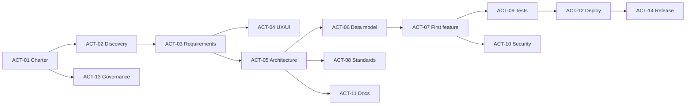

# Implementation Plan A–G (ACT-01 … ACT-07)

- Status: **ACTIVE — v0.1, 2026-11-12**
- Rule: this plan is a roadmap, not evidence. An activity is complete only with status DONE **and** evidence, after its acceptance criterion is verified by the owner.

## Dependency graph (from the workbook)



Note: the formal chain puts ACT-02 (real interviews) before ACT-03..07. This session produced drafts and a technical spike for A–G in parallel; their approval still follows the chain.

## Stages

| Stage | ACT | Deliverable | Produced now | Acceptance test | Suggested status (owner decides) |
| --- | --- | --- | --- | --- | --- |
| A | 01 | `docs/product/01_project-charter_v0.1.md` | Draft | Owner approves problem, users, 3 measurable objectives, out of scope | PREPARED |
| B | 02 | `docs/product/02_discovery-notes_v0.1.md` | Template only | 5 real interviews + 3 patterns recorded | NOT STARTED |
| C | 03 | `docs/product/03_requirements_v0.1.md` | Draft (16 FR, 7 NFR) | Every requirement has ID + verifiable criterion; owner review after B | PREPARED |
| D | 04 | `docs/design/04_user-flows_v0.1.md` (+ PDF export) | Draft | Main flow and screens reviewed; a11y checklist ticked | PREPARED |
| E | 05 | `docs/architecture/05_adr-001_stack.md` | Proposed | Two options compared; owner approves decision and consequences | IN REVIEW |
| F | 06 | `docs/architecture/06_data-model_v0.1.md` | Draft + implemented schema | All data requirements mapped; schema reviewed | PREPARED |
| G | 07 | Working feature + commit | Implemented locally | Runs locally, tests pass, commit exists (see verification) | IN REVIEW (evidence candidate: commit SHA) |

## Verification for G (executed 2026-11-12)

```gherkin
Feature: First vertical slice
  Scenario: Evidence-based completion
    Given ACT-01 is NOT STARTED and the dashboard shows 0%
    When the user sets ACT-01 to DONE without evidence
    Then ACT-01 is flagged NO EVIDENCE and the dashboard still shows 0%
    When the user adds file evidence "docs/product/01_project-charter_v0.1.md"
    Then ACT-01 is effectively done and the dashboard shows 7% (1/14)
```

Automated in `tests/e2e/first-feature.spec.ts`, `tests/integration/api.test.ts`, `tests/unit/rules.test.ts`.

## Next stages (after approval)

| Next | Work |
| --- | --- |
| ACT-08 | Document standards already applied (Conventional Commits, ESLint, strict TS, branch strategy) |
| ACT-09 | Test report from CI run; add a11y automated checks (axe) |
| ACT-10 | OWASP checklist; design auth (D-006) before any public URL |
| ACT-12 | `wrangler d1 create`, set `database_id`, remote migrations, deploy — requires approval |
| ACT-13 | Keep `docs/governance/13_decision-log.md`; add top-5 risks with owners |
| ACT-14 | SemVer, CHANGELOG, tag v0.1.0 |

## Risks (FMEA, 1–5 scale; RPN = S × O × D)

| Failure mode | Effect | S | O | D | RPN | Mitigation |
| --- | --- | --- | --- | --- | --- | --- |
| Activities marked DONE without proof | False progress | 5 | 3 | 1 | 15 | Rule FR-08 + tests; evidence format validation |
| App exposed publicly without auth | Anyone can change data | 5 | 2 | 2 | 20 | No deploy until D-006; README warning |
| Manual template drifts from official Cloudflare template | Upgrade friction | 3 | 3 | 3 | 27 | Compare when network allows; pin versions |
| Requirements written before discovery | Wrong product | 4 | 3 | 3 | 36 | Run ACT-02; revise ACT-03 |
| Concurrent edits overwrite each other | Lost updates | 3 | 2 | 4 | 24 | Single user now; add `rev` before multi-user |
| Workbook changes after import | Divergence | 2 | 3 | 3 | 18 | One-time import default (D-005); fixture records source sha256 |
