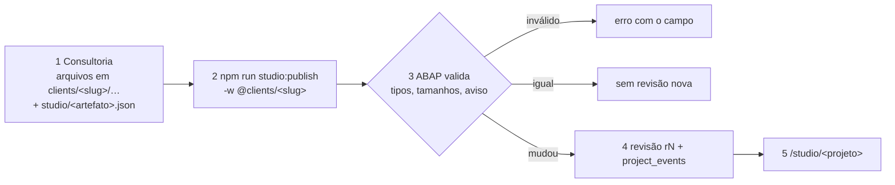
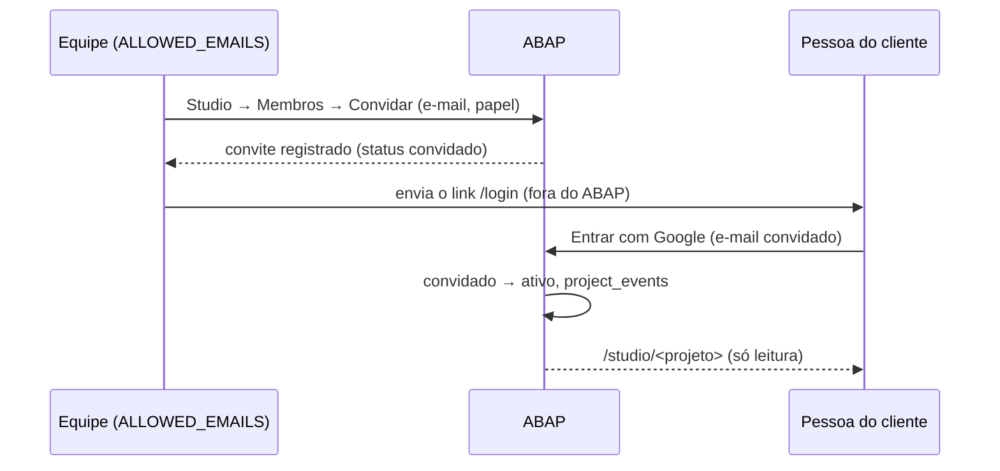
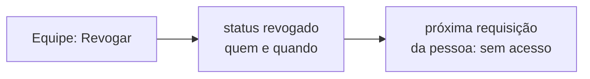

# Studio — workflows (ADR-011)

Three workflows. Each step names who does it and where.

## W1 · Publicar um artefato no studio do cliente

| Passo | Regra |
|---|---|
| Manifesto | `slug`, `title`, `notice` (obrigatório), `entry` (.html), `dir` dentro do workspace do cliente |
| Token | Pessoal, role **write** (`ABAP_TOKEN` ou `.abap-token`, nunca no Git) |
| Resultado | Revisão nova só quando o conteúdo muda |

## W2 · Convidar uma pessoa do cliente

| Regra | Detalhe |
|---|---|
| Quem convida | Só a equipe, no app. Sem MCP, sem token |
| O que o convidado vê | Só o studio dos projetos que o convidaram. Governança, modelos, Drive, tokens e outros projetos: bloqueados |
| Conta | Conta Google do e-mail convidado |

## W3 · Revogar o acesso

O registro nunca é apagado. Convidar de novo reativa a pessoa como "convidado".
