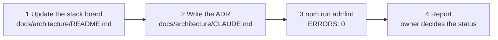

# Claude Code — Client PRJ-01 · CleanSea

This folder is one **client workspace** of the ABAP monorepo. The repository root `CLAUDE.md` applies too; this file adds the client rules. On conflict, the stricter rule wins.

## Mission
Turn the client's material into **structured, verifiable documentation**, then into code, following the 14-activity governance model (ACT-01…ACT-14). Documentation comes first; code starts only after its gates pass.

## Sources of truth (in this order)
1. **`docs/drive/`** — Markdown mirror of the client's Google Drive folder (PRJ-01-CLEANSEA). Read-only here. Regenerate with `npm run docs:pull -w @clients/prj-01-cleansea`. Check `docs/drive/_manifest.json` for what exists and when it changed.
2. **Project in ABAP** (`projectId = prj-01-cleansea`) — status, owner, due date and evidence of ACT-01…ACT-14, synced from the client's project spreadsheet. Read it through the ABAP API or ask the owner; never guess a status.
3. **`models/`** — process models. `models/_abap/` is exported from ABAP by `npm run models:pull -w @clients/prj-01-cleansea` (read-only here; edit in the app, *Modelos*). Hand-made sources (`ORG-NN.json`, `FLW-NN.json`, diagnostic sessions) sit in `models/` and are imported through the app.
4. **`plugin/`** — this client's Claude agent, generated by ABAP (factory) and written by `npm run plugin:pull -w @clients/prj-01-cleansea`. Read-only here; regenerate in the app (*Agente*).
5. **`docs/<area>/`** — our structured deliverables (see `docs/README.md` for the ACT → file map).

If a fact is not in (1) or (2), it is an **assumption**: write `[ASSUMPTION]` next to it and list it in the deliverable's open questions.

## Before any task
1. Read `client.json`, `README.md`, `docs/README.md` and `docs/drive/_manifest.json`.
2. Identify the ACT ID, its dependency, deliverable path and acceptance criterion (same as the governance workbook).
3. Check the dependency is effectively done (DONE with evidence) in ABAP. If not, you may draft, but mark the file `Status: DRAFT — blocked by ACT-xx`.
4. State the smallest change and how it will be verified.

## Documentation rules
- One deliverable per ACT, at the path in `docs/README.md`. Header: ACT ID, status (`DRAFT` / `IN REVIEW` / `APPROVED`), date, sources used (file names from `docs/drive/`).
- Requirements: EARS wording + RFC 2119 (MUST/SHOULD/MAY) + one GIVEN–WHEN–THEN per requirement, each with a stable ID (`PRJ-01-FR-01`).
- Cite the Drive source for every client fact: `(fonte: docs/drive/<file>.md)`.
- Client-facing text in **pt-BR**, plain language. Technical files may be in English.
- Prefer diagrams (Mermaid) when they explain flow, structure or dependencies better than text. The Mermaid export of each diagnostic is in the app (*Modelos → Mermaid*).
- Visual style: the ABAP design system only. Never copy styles or colours from client files in `reference/`.
- Never invent interviews, approvals, numbers, people or test results.

## Architecture decisions and stack (ACT-05)
Entry point: `docs/architecture/README.md` (stack board). Rules and ADR register: `docs/architecture/CLAUDE.md`. Read both before any ADR or stack work.

- **README first.** WHEN you record, change or supersede an ADR THEN update the stack board at the top of `docs/architecture/README.md` **before** you write the ADR description. The status in the README MUST equal the status in the ADR.
- New ADRs start as `Proposed`. Only the owner sets `Accepted`. An Accepted ADR is append-only: supersede it, do not edit it.
- Each stack choice needs an ADR. A choice without an ADR shows `[OPEN]`.
- Run `npm run adr:lint -w @clients/prj-01-cleansea` after each change. Do not call an ADR change done until the linter shows `ERRORS: 0`. If it cannot reach 0, report the remaining errors. Do not edit the linter to make it pass.
- `as_built: VERIFIED` needs `CODE` or `TEST` evidence. A design prototype is not code.

## Document style: visual-first
Full specification: `docs/architecture/CLAUDE.md`, section 2.13. It applies to every deliverable in `docs/`.

| Content | Form |
|---|---|
| Flow, states, structure, dependencies | Mermaid diagram (with `accTitle` and `accDescr`, aim for 12 nodes or fewer; split a bigger diagram into linked diagrams) |
| Comparison, options, status of many items | Table |
| Reason (why), normative rule (MUST, SHALL) | Short sentences |
| Long evidence, raw output | `
` below the summary |

- Order: one-line summary → diagram or board → tables → details on demand.
- **Reformat only.** A visual form MUST keep each fact, ID, number, status tag and requirement. Never trade accuracy for a visual.
- Write each status as a word. Color and glyphs are additions only.

## Code rules (only after ACT-03, ACT-05 and ACT-06 are APPROVED)
- Code lives in `src/` (or a new `apps/<client-app>/` workspace when it needs its own deploy). Follow the stack decided in this client's ADR, not the ABAP stack by default.
- Reuse shared code only from `packages/*`. Never import from another client's folder.
- Tests are part of the deliverable (unit + one end-to-end path per critical flow).

## Data and privacy
- **No secrets, tokens, Drive or spreadsheet IDs, personal e-mails or client personal data in Git.** IDs live in ABAP project settings.
- `docs/drive/` may contain client business information: keep it inside this folder; do not copy it into other clients or into `apps/abap`.
- Data marked "não validado" stays marked until the client confirms it.

## Writing back to the client's Drive
Only through ABAP (`/projects/prj-01-cleansea/drive` in the app or the API), after explicit approval by the owner. Every write is audited. Never edit the Drive directly from scripts in this folder.

## Done = verified
A deliverable is ready for review when: sources cited, assumptions listed, acceptance criterion checked, and (for code) tests pass. Do not mark an activity DONE: the owner does it in the spreadsheet with evidence.

## Material that already exists (NOT validated)
Before the Drive sync, the only CleanSea material in the repo came from earlier prototypes. Use it as background, never as fact:
- `apps/abap/data/reference/cleansea.v1.json` — operational model extracted from a prototype: 17 steps in 6 phases (A–F), people, 4 documents (D1–D4), 7 open gaps. Status: **não validado**.
- `apps/abap/reference/loop-design/` — ADR-002/003 (cite 23 activities in 7 phases; the source file `Clean Sea Pipeline Completo.md` was never provided) and the HTML prototypes `cleansea-*.html`.
- In ABAP, the Canvas dataset "CleanSea — Studio LOOP" shows this model.
- `reference/design-handoff-cleansea-app/` — design handoff of the mobile app received on 2026-11-15: a navigable HTML prototype (screens M00–M15, 5 roles, permission matrix, 17 steps, offline queue) and its README. It is a **design reference, not production code**: seeded data, no API, simulated integrations. The `_ds/` design-system bundle is included so the prototype renders. It is published to the ABAP Studio of this project (`studio/prototipo-app-mobile.json`, `npm run studio:publish -w @clients/prj-01-cleansea`, ADR-014). Its permission matrix, states and open items are proposals until the client confirms them (ADR-013).

When `docs/drive/` contains the real pipeline, it replaces this material: list the differences in `docs/governance/13_decisions-risks_v0.1.md`.

## Session handoff
End each session with: files changed, sources read, assumptions added, open questions for the client, next ACT ID, exact resume step.
