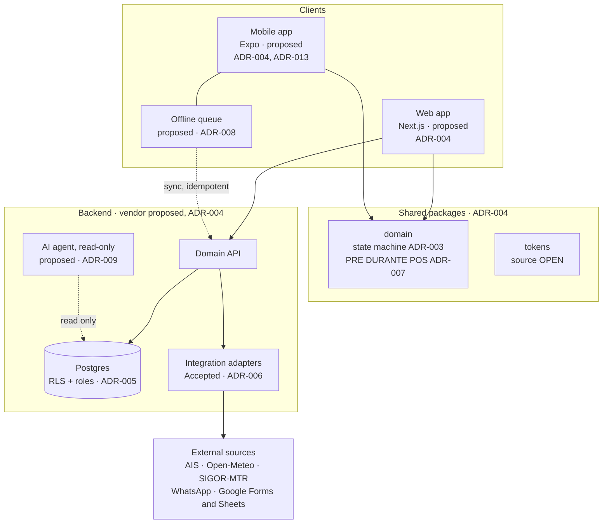
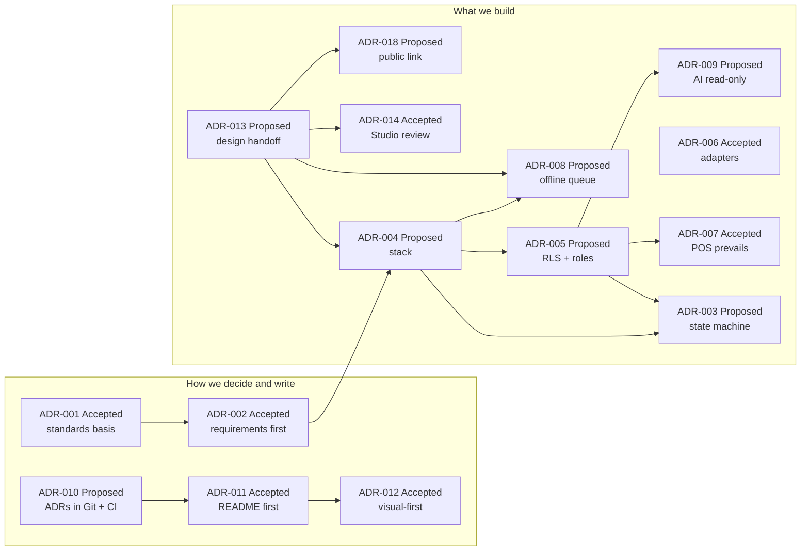
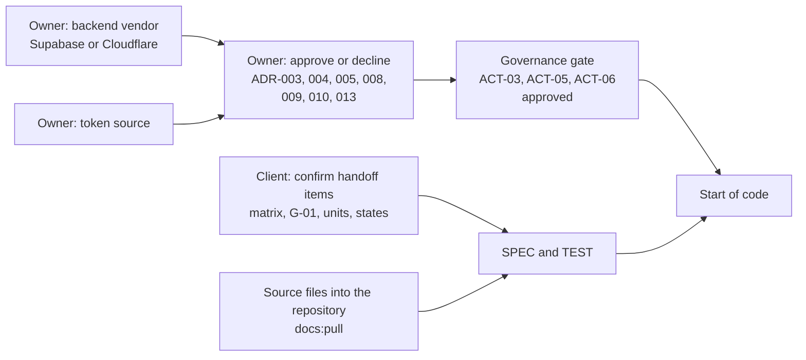

# CleanSea — Architecture and stack

Stack board of the CleanSea app (PRJ-01, ACT-05). **Draft for owner review.** Status on 2026-11-15: 8 decisions 🟢 Accepted, 10 🟡 Proposed, no production code yet.

## Stack

> Update this board **first** when you record or change an ADR (rule 12.1 in [`CLAUDE.md`](./CLAUDE.md)). The status here MUST equal the status in the ADR. The linter checks it.

| Layer | Choice | Status | ADR |
|---|---|---|---|
| Software category | Enterprise Application Software. Internal Business Management System. No ERP scope | 🟢 Accepted | ADR-001 |
| Documentation basis | arc42 · ISO/IEC/IEEE 12207 · NIST SP 800-160 and SP 800-218 · BPMN 2.0.2 · Camunda practices | 🟢 Accepted | ADR-001 |
| Delivery order | BRD → PRD → FRD → SPEC → code → TEST, with the start-of-code gate CR-001 to CR-004 | 🟢 Accepted | ADR-002 |
| Process engine | Typed state machine in application code. BPMN diagrams as documentation. No custom BPMN engine | 🟡 Proposed | ADR-003 |
| Repository layout | One monorepo: `apps/web`, `apps/mobile`, `packages/domain`, `packages/api-client`, `packages/tokens` | 🟡 Proposed | ADR-004 |
| Language | TypeScript `[HYPOTHESIS]` | 🟡 Proposed | ADR-004 |
| Web app | Next.js (React, shadcn/ui) | 🟡 Proposed | ADR-004 |
| Mobile app | Expo (React Native) | 🟡 Proposed | ADR-004 |
| Mobile UI reference | Design handoff: HTML prototype, screens M00 to M15, 5 roles. Rebuild it. Do not ship it | 🟡 Proposed | ADR-013 |
| Prototype review with the client | ABAP Studio of the project (`abap-manegement.adm-loop-app.workers.dev/studio/prj-01-cleansea`): invited client logins, sandboxed prototype with a notice | 🟢 Accepted | ADR-014 |
| Public prototype link | Static Worker `clema` on workers.dev (`clema.adm-loop-app.workers.dev`), deployed by Workers Builds from `/clients/prj-01-cleansea`: no login, notice banner on every page, `noindex`. Simulated data only | 🟡 Proposed | ADR-018 |
| Vessel tracking in the prototype | Widget inside the prototype: Leaflet + OpenStreetMap map, proximity push (50 mn, 12 mn, berth), data crossing, Open-Meteo weather. AIS simulated | 🟢 Accepted | ADR-017 |
| Vessel identity, positions, ETA | Internal IDs + IMO (identity) + MMSI (complement) + provider ID map; positions with source and two timestamps; ETA observations kept, priority and validity rule | 🟡 Proposed | ADR-015 |
| WhatsApp | WhatsApp Business Platform, webhook, association to the operation (code, vessel, human confirmation), original message ID against duplicates | 🟡 Proposed | ADR-016 |
| AIS provider | ⚪ `[OPEN]` MarineTraffic (Kpler) or another AIS API: contract, limits, rights of use | ⚪ `[OPEN]` | — |
| Database, auth, storage, realtime | Supabase (Postgres) `[ASSUMPTION]`. Alternative: Cloudflare Workers and D1 | 🟡 Proposed | ADR-004 |
| Web hosting | Vercel `[ASSUMPTION]` | 🟡 Proposed | ADR-004 |
| Mobile build and updates | EAS Build, Submit and Update `[ASSUMPTION]` | 🟡 Proposed | ADR-004 |
| Access control | `tenant_id` on each business table. Row-Level Security and roles. Deny by default | 🟡 Proposed | ADR-005 |
| External integrations | Server-side adapters. Secrets on the server. Provenance on each ETA. Human approval before an official submission | 🟢 Accepted | ADR-006 |
| Measurement rule | PRE, DURANTE, POS stored separately. POS prevails. Missing value shows "—" | 🟢 Accepted | ADR-007 |
| Offline (mobile) | Queue of writes on the device with idempotency keys. Valid only if the signal hypothesis is confirmed | 🟡 Proposed | ADR-008 |
| AI agent | Read-only retrieval, tenant-scoped, with citations. MCP tools read-only | 🟡 Proposed | ADR-009 |
| ADR storage and check | Markdown in Git in this directory. Linter in CI | 🟡 Proposed | ADR-010 |
| README stack board | This board is updated before each ADR record | 🟢 Accepted | ADR-011 |
| Document style | Visual-first, without loss of content | 🟢 Accepted | ADR-012 |
| Design tokens | ⚪ `[OPEN]` Handoff design system, client brand or ABAP design system | ⚪ `[OPEN]` | — |
| Local store on the device | ⚪ `[OPEN]` WatermelonDB or SQLite (handoff suggestion) | ⚪ `[OPEN]` | — |
| Place of the client code | ⚪ `[OPEN]` `clients/prj-01-cleansea/src/` or `apps/<client-app>/` | ⚪ `[OPEN]` | — |
| CI for the app, tests, observability | ⚪ `[OPEN]` No decision | ⚪ `[OPEN]` | — |

Legend: 🟢 Accepted = the owner approved · 🟡 Proposed = waits for the owner · ⚪ `[OPEN]` = no ADR. `[ASSUMPTION]` and `[HYPOTHESIS]` = not confirmed.
No row is as-built. The repository has no production app code (`as_built` is `UNVERIFIED` or `N/A` in each ADR).

## Target architecture

Proposed. Dashed lines and "proposed" labels are not decided.



## Decision map



## ADR index

Full records: [`CLAUDE.md`, Act 3](./CLAUDE.md#act-3--adr-register-cleansea).

| ID | Title | Status | as_built |
|---|---|---|---|
| ADR-001 | Use EAS category, arc42, ISO/IEC/IEEE 12207, Camunda practices and NIST as the documentation basis | 🟢 Accepted | N/A |
| ADR-002 | Require requirements before code and apply the start-of-code gate | 🟢 Accepted | N/A |
| ADR-003 | Do not build a custom BPMN engine without proven need | 🟡 Proposed | UNVERIFIED |
| ADR-004 | Deliver web and mobile from one monorepo (Next.js, Expo, Supabase, Vercel, EAS) | 🟡 Proposed | UNVERIFIED |
| ADR-005 | Enforce multi-tenancy and roles in the database (RLS and RBAC) | 🟡 Proposed | UNVERIFIED |
| ADR-006 | Call external sources from server-side adapters under the integration rules | 🟢 Accepted | UNVERIFIED |
| ADR-007 | Apply the PRE, DURANTE, POS rule. POS prevails | 🟢 Accepted | UNVERIFIED |
| ADR-008 | Queue field writes offline on mobile | 🟡 Proposed | UNVERIFIED |
| ADR-009 | Limit the AI agent to read-only tenant-scoped retrieval | 🟡 Proposed | UNVERIFIED |
| ADR-010 | Keep ADRs as versioned Markdown and validate them in CI | 🟡 Proposed | N/A |
| ADR-011 | Update the README stack board before each ADR record | 🟢 Accepted | N/A |
| ADR-012 | Write documents visual-first without loss of content | 🟢 Accepted | N/A |
| ADR-013 | Use the design handoff as the front-end reference for release 1 | 🟡 Proposed | UNVERIFIED |
| ADR-014 | Review the prototype with the client in the ABAP project Studio | 🟢 Accepted | VERIFIED |
| ADR-015 | Identify vessels by IMO with provider ID maps, and keep every position and ETA observation | 🟡 Proposed | UNVERIFIED |
| ADR-016 | Mirror WhatsApp through the WhatsApp Business Platform and associate each message to one operation | 🟡 Proposed | UNVERIFIED |
| ADR-017 | Put the vessel tracking widget inside the prototype with proximity push and data crossing | 🟢 Accepted | VERIFIED |
| ADR-018 | Publish the prototype on a public Worker without login | 🟡 Proposed | UNVERIFIED |

## Decision cards

One line for each ADR. The ADR text is the source (VS-07).

| ADR | Decision in one line | Main cost or risk | Revisit when |
|---|---|---|---|
| ADR-001 | Combine recognized standards. Do not claim ERP scope | The standards leave gaps. ADRs fill them | SSDF v1.2 is final, or the 12207 edition differs |
| ADR-002 | Requirements first. A feature passes CR-001 to CR-004 before code | Slower first start. SPEC and TEST do not exist yet | After the first release, or a feature cannot pass the gate |
| ADR-003 | State machine in code for the operation lifecycle only. Store `process_version` | Timers and escalation need custom code. Scope creep toward an engine | Triggers T1 to T5 (thresholds `[OPEN]`) |
| ADR-004 | One monorepo. Next.js, Expo, Supabase, Vercel, EAS. Share logic and tokens, not UI | Two UI layers. Two release channels. Vendors not confirmed | The as-built scan shows a different stack |
| ADR-005 | `tenant_id` on each table. Access enforced in the database. Append-only audit log | Policies need automated tests | A client-facing role is added, or an audit finds a gap |
| ADR-006 | Server-side adapters. No scraping. Ventusky as a link only. Open-Meteo with attribution | Provider contracts and limits are not verified | A provider offers or removes an API |
| ADR-007 | Effective value = POS, else DURANTE, else PRE. No automatic unit conversion | Needs a unit rule and a divergence margin | The owner sets the unit or the margin |
| ADR-008 | Queue measurements, photos and messages offline. The user solves conflicts | Conflict handling. Protection of local data | The signal survey result is known |
| ADR-009 | AI agent read-only in release 1, filtered by tenant and role, with citations | Answer quality depends on data quality | The owner asks for agent actions |
| ADR-010 | ADRs in Git in this directory. The linter runs on each pull request | The linter checks form, not truth | The team adds a documentation tool |
| ADR-011 | Update this README before each ADR record. The linter compares the two files | One more step for each ADR | The stack data moves to a structured file |
| ADR-012 | Summary, then diagram, then tables, then details. No loss of content | Diagrams can drift from the text | A reader reports a hidden requirement |
| ADR-013 | Rebuild the mobile screens from the handoff. No seed data or "SIMULADO" in production | The handoff has items the client did not confirm | The client answers the open items |
| ADR-014 | Publish the prototype in the ABAP Studio of PRJ-01. Client people see it by invitation only | Guests need a Google account. Production needs migration 0007 + deploy | The client needs to comment or upload in the studio |
| ADR-015 | Internal IDs + IMO + MMSI + provider map. Position = lat, lon, source, observed and collected time. ETA observations kept; manual > port > agency > AIS, each with a validity | Each provider needs an adapter and a contract | An AIS provider is contracted |
| ADR-016 | WhatsApp Business webhook. Associate by `#OP-` code, then vessel name, then human confirmation. Keep the original message ID | Meta business verification and message costs | The client confirms the business number |
| ADR-017 | Tracking widget inside the prototype (phone push banners, M06 card, full panel). AIS simulated, weather live when possible | Simulated positions may be read as real. Every simulated value carries SIMULADO | A real AIS contract exists, or the production app replaces the prototype |
| ADR-018 | Public static Worker for the prototype, no login. The Studio (ADR-014) stays for invited review | Anyone with the link sees the prototype, including client agencies and operation volumes from the unvalidated spreadsheet | The link leaks to a third party, the client objects, or the production app replaces the prototype |

## What blocks the stack



Full list: [`CLAUDE.md`, Act 5](./CLAUDE.md#act-5--open-items) (22 items).

## Files in this directory

| File | Content |
|---|---|
| `README.md` | This board. Engineering entry point |
| [`CLAUDE.md`](./CLAUDE.md) | Agent rules, framework, document style (2.13), full ADR register, traceability matrix, open items |
| [`../../tools/adr-lint.py`](../../tools/adr-lint.py) | Linter for the two files |

```bash
npm run adr:lint -w @clients/prj-01-cleansea
```
