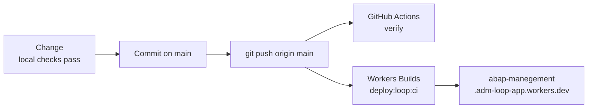

# Branch policy — single branch `main`

Owner decision, 2026-11-15 (ABAP D-039). One branch holds all work and is the production source.

| Rule | Detail |
|---|---|
| BR-01 | `main` is the only long-lived branch and the GitHub default branch. |
| BR-02 | Agents and people commit and push directly to `main`. No draft pull request and no confirmation question are needed for a merge into `main`. |
| BR-03 | Before each push, run the checks of the changed area: `npm run lint`, `npm run typecheck`, `npm test`, `npm run check:clients`, and `npm run adr:lint -w @clients/<slug>` for ADR changes. Never push when a check fails. |
| BR-04 | A temporary branch is allowed only when the owner asks for one. Merge it into `main` and delete it the same day. |
| BR-05 | Never force-push `main`. Never rewrite its history. Revert with a new commit. |
| BR-06 | Each push to `main` deploys production through Cloudflare Workers Builds (Worker `abap-manegement`). A red build is fixed on `main` at once. |
| BR-07 | Destructive or outward actions keep their own approval rules (root `CLAUDE.md`): deleting a project, writing to a client Drive, production data changes. |

Owner settings (GitHub, one time): Settings → General → Default branch = `main`; then delete the other branches. Branch protection, if added, MUST allow the agent to push to `main`.
