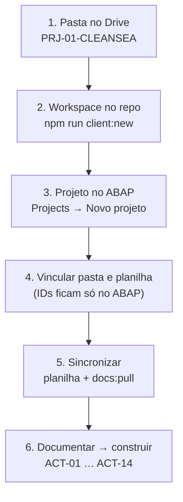

# Entrada de um novo cliente

Do Drive ao código, em 6 passos. Exemplo: **PRJ-01 · CleanSea**.



## 1. Pasta do cliente no Google Drive

Nome: `PRJ-NN-NOME` (ex.: `PRJ-01-CLEANSEA`). Conteúdo recomendado:

| Item | Formato | Para quê |
|---|---|---|
| Planilha do projeto | Google Sheets, cópia do *Full Stack Governance Workbook* (aba `DATA_Activities`) | Status, responsável, prazo e evidência das 14 atividades |
| Documentos do cliente | Google Docs (viram Markdown); PDFs e outros arquivos ficam listados | Fonte dos fatos do cliente |

- Compartilhe a pasta com a conta Google que conectou o ABAP (Settings → Google).
- Prefira Google Docs: só eles são convertidos em Markdown para o repositório.

## 2. Workspace no repositório

```bash
npm run client:new -- PRJ-01 "CleanSea" PRJ-01-CLEANSEA
```

```bash
npm install
```

Cria `clients/prj-01-cleansea/` com `CLAUDE.md`, `client.json`, `README.md` e `docs/`. Confira com `npm run check:clients`.

## 3. Projeto no ABAP

No app: **Projects → Novo projeto**, com o mesmo identificador (`prj-01-cleansea`), o código (`PRJ-01`) e o nome. O ABAP cria as 14 atividades do modelo de governança.

## 4. Vincular pasta e planilha

Na página do projeto, em **Google Drive**, cole o link da pasta do cliente. O ABAP encontra a planilha de governança dentro dela (ou você cola o link da planilha). Os IDs ficam só no banco do ABAP, nunca no Git.

## 5. Sincronizar

- **Planilha:** automático ao abrir o Dashboard do projeto (ou Prévia + Aplicar).
- **Documentos no app:** página **Docs** do projeto (lista, leitura e publicação aprovada no Drive).
- **Documentos no repositório:**

```bash
npm run docs:pull -w @clients/prj-01-cleansea
```

Precisa de `ABAP_URL` e `ABAP_API_TOKEN` (token de máquina, só leitura; peça ao administrador). Escreve `clients/prj-01-cleansea/docs/drive/*.md` e `_manifest.json`.

## 6. Documentar e construir

Abra o Claude Code na raiz do repositório e peça o trabalho do cliente. O Claude lê `clients/<slug>/CLAUDE.md`, usa `docs/drive/` como fonte e produz os entregáveis em `docs/<área>/`. Código só depois de ACT-03, ACT-05 e ACT-06 aprovados.

## Regras que valem para todos os clientes
- Nada de segredos, IDs do Drive/Sheets ou dados pessoais no Git (`npm run check:clients` verifica).
- Um cliente nunca acessa a pasta de outro.
- Escrita no Drive do cliente só pelo ABAP, com aprovação e registro.
