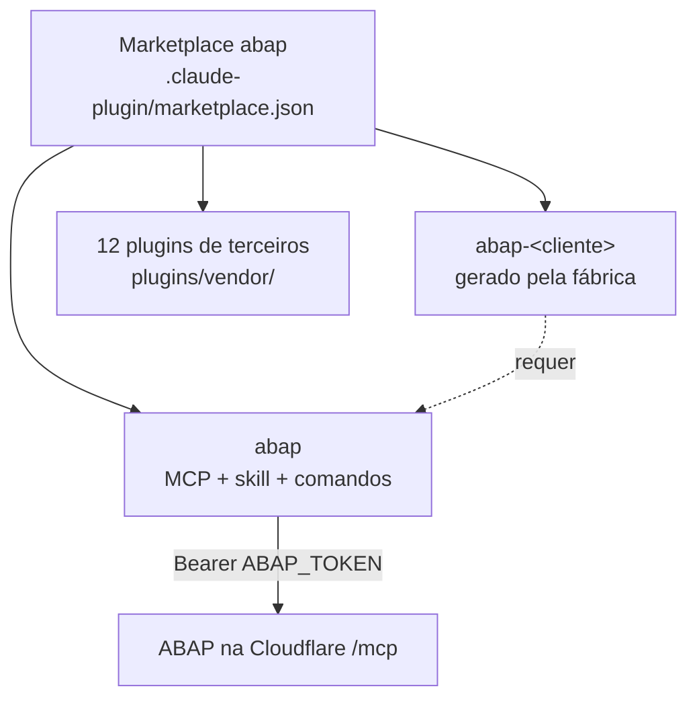

# Plugins e agentes — catálogo do marketplace `abap`

O repositório é o marketplace do time. Quem abre o repositório no Claude Code recebe o marketplace e o stack padrão (`.claude/settings.json`).

## Começar (cada pessoa, uma vez)
1. ABAP → **Settings → Tokens de API** → criar token (aparece uma única vez).
2. Guardar em `ABAP_TOKEN` no ambiente do computador. Nunca no Git nem no chat.
3. No Claude Code: `/plugin marketplace add loopappdev/abap-manegement` e `/plugin install abap@abap` (ou só abrir este repositório).
4. Conferir com `/mcp`: `abap` conectado.

## Nossos plugins
| Plugin | O que faz |
|---|---|
| `abap` | 25 ferramentas `abap_*` (projetos, atividades, modelos, Drive, planilha, fábrica), skill `abap-workflow`, `/abap-status`, `/abap-diagnostico`, `/abap-sync` |
| `abap-<cliente>` | Agente do cliente: skill de contexto + subagentes analista e processos + `/<cliente>-status`. Gerado no ABAP (**Agente**), trazido com `npm run plugin:pull -w @clients/<slug>` |

## Plugins de terceiros (copiados como recebidos)
| Plugin | Versão | Para quê | Licença | Ligado por padrão |
|---|---|---|---|---|
| agent-engineering | 0.3.2 | Planejar, implementar, revisar e publicar mudanças com checagens | MIT | sim |
| backend-design | 0.2.0 | Reflexos de backend: dados, migrações, segurança, testes (com verificações locais ao editar) | MIT | sim |
| senior-engineering-partner | 1.28.0 | Revisor e par de programação, segurança primeiro | Apache-2.0 | sim |
| modern-web-guidance | 0.0.194 | Boas práticas web atuais | Apache-2.0 | sim |
| agent-handoff | 0.4.2 | Fluxo planejar → executar → verificar com estado em disco | MIT | sim |
| ai-firstify | 1.1.0 | Auditoria "AI-first" de projetos | **sem arquivo de licença** | sim |
| engineering | 1.2.0 | Standups, revisão, incidentes, documentação (usa conectores externos) | **sem arquivo de licença** | não |
| customer-support | 1.3.0 | Triagem e respostas de suporte (usa conectores externos) | Apache-2.0 | não |
| cowork-plugin-management | 0.2.2 | Criar e ajustar plugins | Apache-2.0 | não |
| expo | 1.12.5 | Apps Expo (telemetria desligada por padrão) | MIT | não |
| prisma | — | MCP do Prisma (Postgres) | **sem arquivo de licença** | não |
| github | — | MCP do GitHub (precisa de token pessoal) | **sem arquivo de licença** | não |

Ligar um que está desligado: `/plugin install <nome>@abap`.

## Regras
- **Atualizar um plugin de terceiros:** substituir a pasta em `plugins/vendor/<nome>/`, manter o `NOTICE.abap.txt`, mudar a versão no `marketplace.json`, rodar `claude plugin validate .`.
- **Sem licença:** uso interno. Confirmar a licença com o autor antes de distribuir fora do time.
- **Antes de ligar por padrão** um plugin com hooks ou servidores MCP: ler os hooks e os endereços. Registrar a revisão no ADR-009.
- **Plugin de cliente:** nunca editar à mão; gerar de novo no ABAP.
- Tokens nunca vão para o Git (`check:clients` bloqueia o padrão `abap_…`).
