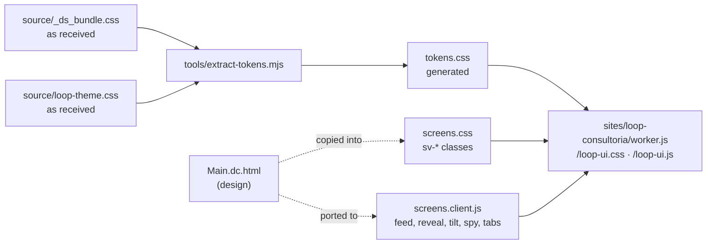

# @loop/ui — Screens v2, exclusive to LOOP

The Loop landing (`sites/loop-consultoria`) is built **only** from this package. It reproduces the Screens v2 page from design artifact `a74ae02c` (`Main.dc.html` + `ds/rc/`), not an adaptation of the ABAP components.



| File | What | Rule |
|---|---|---|
| `source/_ds_bundle.css`, `source/loop-theme.css` | Design files as received | Never edit. The test checks the SHA-256 hashes. Replace both together when the design changes |
| `tokens.css` | Every `:root` / `[data-theme]` token of the bundle (with its `@media`), then `loop-theme.css` verbatim | Generated: `npm run tokens -w @loop/ui`. The test fails if it is stale |
| `screens.css` | The Main.dc.html elements as classes: header + tabs, hero feed panel, display title, meta row, tiles, rows, stories, chips, article layout with TOC, segmented control, panel + bubble, 3D stage + parts, rail, FAQ, form, footer | Values copied from the inline styles of the design. Prefix `sv-` |
| `screens.client.js` | Behaviour of the design component: endless feed + pause, reveal (24 px, 90 ms stagger), tilt, scroll spy, tabs with fade, theme from the OS | No dependencies. Served as `/loop-ui.js` |

## Why a separate package
`@abap/ui` shares one token contract between ABAP and LOOP. Mapping Screens v2 onto that contract changed the look too much (owner, 2026-11-15: "you are adapting where you should follow this page"). This package follows the design one to one and has no ABAP consumer. Decision D-040.

## Verify
```bash
npm run test:tools
```
```bash
node sites/loop-consultoria/validate.cjs https://loop-consultoria.adm-loop-app.workers.dev
```
