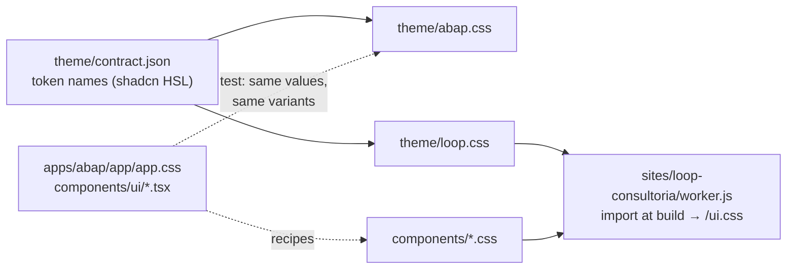

# @abap/ui

> 2026-11-15 (D-040): the Loop landing no longer imports this package. It uses the exclusive [`@loop/ui`](../loop-ui/README.md), which follows the Screens v2 design one to one. The sections below describe the integration as it was (traceability A–D); the LOOP theme stays here for reference.

One UI contract for the ABAP platform and the Loop Consultoria landing.



## B · Theme: one structure, two themes

| File | Values | Rule |
|---|---|---|
| `theme/contract.json` | Names only: 19 colours + `radius` (shadcn/ui HSL channels, used as `hsl(var(--name))`) | Every theme MUST define every name |
| `theme/abap.css` | ABAP neutral bundle (ADR-007) | MUST equal `apps/abap/app/app.css` (test) |
| `theme/loop.css` | Screens v2 design system: `loop-theme.css` palette + rc bundle scale (type, space, radius, motion), light and dark | Extensions use `--loop-*`; scale values equal the design bundle (test). Text pairs ≥ 4.5:1 (test) |
| `--ui-*` hooks | Optional theme knobs read by the recipes: `--ui-button-radius`, `--ui-button-shadow`, `--ui-outline-border`, `--ui-badge-radius`, `--ui-field-radius`, `--ui-card-shadow`, `--ui-card-border` | Each hook has the ABAP value as fallback; ABAP sets none (test) |

## C · Components: only what both use

| Component | ABAP source | Landing use |
|---|---|---|
| Button (6 variants, 4 sizes) | `button.tsx` | Nav, hero, CTAs, form, pause |
| Card, CardTitle | `card.tsx` | Problem, capabilities, services, steps, trust, simulator, form |
| Badge | `badge.tsx` | Labels, statuses, connectors |
| Input, Textarea, Label | `input.tsx` | Form, simulator labels |
| Separator | `separator.tsx` | Simulator, footer |

Not shared (used by one side only): ABAP `resizable`, `tabs`, `toggle`, `toggle-group`, `tooltip`; landing accordion, checkbox and slider (local CSS in `sites/loop-consultoria/index.html`, same tokens). Promote one here when the other side needs it.

The recipes are CSS so that a static page can use them without React. The ABAP app keeps its React components (Tailwind); a test checks that every ABAP button variant and size exists in `button.css`.

## D · Verification

```bash
npm run test:tools
```

`test/ui.test.mjs` checks: contract coverage in both themes (and LOOP dark), ABAP theme equal to the app, WCAG AA text pairs, ABAP button variant parity, shared set equal to the ABAP components, landing imports every package file and uses only defined `ui-*` classes. The landing build (`wrangler deploy`) fails if an import is missing.
