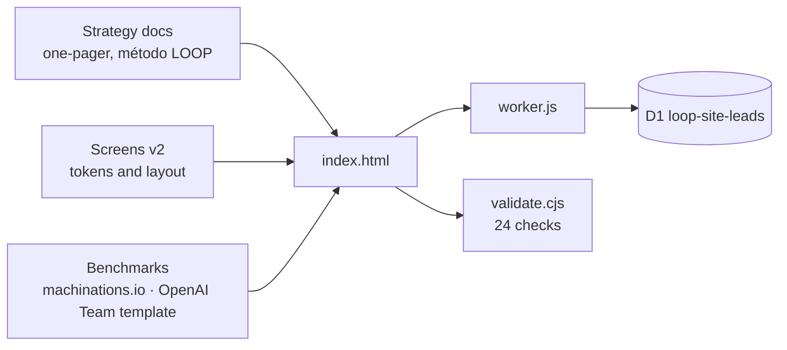

# Loop Consultoria — landing page

One conversion page for the consultancy. Live: `https://loop-consultoria.adm-loop-app.workers.dev`.
Cloudflare Workers Builds deploys it from `main` when a file in this folder changes.



## A · Traceability (code → branch → build → URL)

| Item | Value |
|---|---|
| Code | `sites/loop-consultoria/` (`index.html`, `worker.js`, `wrangler.jsonc`) + `packages/ui/` |
| Branch | `main` (single-branch policy, `docs/branch-policy.md`) |
| Build | Cloudflare Workers Builds, Worker `loop-consultoria` (account adm-loop-app), root `/sites/loop-consultoria`, deploy `npx wrangler deploy`, runs when `sites/loop-consultoria/*` or `packages/ui/*` changes |
| URL | `https://loop-consultoria.adm-loop-app.workers.dev` · stylesheet `/ui.css` is built from `@abap/ui` |
| Data | D1 `loop-site-leads` |

## Design system

Since 2026-11-15 (D-040) the page is rebuilt from scratch on **Screens v2** with the exclusive package [`@loop/ui`](../../packages/loop-ui/README.md). The layout follows `Main.dc.html` element by element; only the copy is Loop's.

| Screens v2 element | Loop content in it |
|---|---|
| Header: logo, pill tab track, tonal + primary buttons | Método, Serviços, Plataforma, Perguntas (scroll spy) · Ver o método · Agendar diagnóstico ↗ |
| Hero panel: endless feed (cards + chips) left, display title right, pause button | Problem and capability labels in the feed; h1 + the two CTAs |
| Title + meta row | Hero subtitle; positioning line and first-call note |
| Featured tiles (square media + title + text) | O custo que ninguém vê (4) |
| News rows (tinted square + title + meta) | Três movimentos (3) |
| Stories (tilt squares) | The three feature blocks, with their product sheets |
| Feed chips | Traga seus sistemas (13) |
| Article layout: TOC + 500 px column | Método (parts grid + 3D stage), simulator in a bordered panel, services (segmented control + panel with bubble and media grid), Como começamos (rail), FAQ, form |

Content check: `node content-baseline.mjs` extracts the visible copy. The rebuild removed no sentence; decorative marks only (`↗`, `● →`, `aria-hidden`).

## Sources and what each one decided

| Source | Used for | Status |
|---|---|---|
| `Screens v2` mockup | Tokens (Loop palette, Inter, radius 16/24), sticky blurred nav with pill menu, hero panel with an animated model beside a large headline, pill buttons | Read and rendered |
| One-pager ABAP, Método LOOP, Especificação LOOP, benchmark | Positioning, six services, six method steps, entry path, security rules, FAQ objections | Read |
| `Site-architecture.md` | Copy limits, layout limits, tone rotation, CTA rule (starts with a verb), "Team" template order | Read |
| machinations.io | Concept: an interactive model in the hero, "make the invisible visible", "explore before it happens", "bring your tools", closing line "model the system, then change the outcome" | Read on 2026-11-15 |
| openai.com/business/solutions/operations | Quality bar. The page returns HTTP 403 to automated reading and nobody bypassed it. Its section order comes from `Site-architecture.md` (Team template) and search snippets | Partial |

Only the information architecture and the concept are reused. Copy, visuals and code are original.

## Section order (Team template × Machinations concept)

| # | Section | Job in the conversion path |
|---|---|---|
| 1 | Hero: headline, one-line value, primary CTA, interactive model | Understand the offer in 5 seconds; try the idea |
| 2 | Problem: four costs of manual work | Recognition |
| 3 | Three capabilities | What we do, in order |
| 4–5 | Two feature rows (visible · simulate) | How it works, with product mock-ups |
| 6 | Method: six steps with a deliverable each | Reduce perceived risk |
| 7 | Six services | Scope |
| 8 | Platform: shared project studio | Differentiator |
| 9 | Connectors | "It works with what I have" |
| 10 | Trust: four rules | Objection: safety |
| 11 | Entry path: five stages | Objection: size of commitment |
| 12 | FAQ: seven questions | Remaining objections |
| 13 | CTA band + form | Convert |

## Acceptance criteria

| ID | Criterion | Check |
|---|---|---|
| LP-01 | One `h1`. Headline and primary CTA are above the fold at 1440×900 and 390×844 | `validate.cjs` |
| LP-02 | One primary action ("Agendar diagnóstico") in the nav, the hero and the form | `validate.cjs` |
| LP-03 | Copy respects the limits of `Site-architecture.md` (hero title 48, subtitle 110, section title 32, card title 28, card description 64, CTA 22) | `validate.cjs` (`data-slot`) |
| LP-04 | CTA labels start with a verb | `validate.cjs` |
| LP-05 | No horizontal scroll at 320, 390 and 1440 px | `validate.cjs` |
| LP-06 | Keyboard: skip link first, visible focus, targets ≥ 36 px; reduced motion stops the animation | `validate.cjs` + CSS |
| LP-07 | The form validates on the client and on the server, needs consent (LGPD), has a honeypot and a flood limit | `validate.cjs --submit`, `worker.js` |
| LP-08 | No invented proof: no client names, logos, testimonials or result numbers. The model is labelled "Exemplo ilustrativo" | Review |
| LP-09 | HTML under 60 KB, no framework, no tracking script | `validate.cjs` |
| LP-10 | Colour is never the only cue: each tinted card repeats its label as text | Review |

```bash
node sites/loop-consultoria/validate.cjs https://loop-consultoria.adm-loop-app.workers.dev
```

## Contact requests

Stored in D1 `loop-site-leads`, table `leads` (name, company, e-mail, message, consent time). Read them in the Cloudflare dashboard (D1 → loop-site-leads → Console): `SELECT * FROM leads ORDER BY id DESC;`. They are personal data: delete on request.

## Open items

- No customer proof yet. Add a case only with the client's written consent.
- No contact channel besides the form. Add WhatsApp or e-mail when the owner chooses one.
- No analytics. Conversion is measured by rows in `leads`.
- Custom domain not set.
